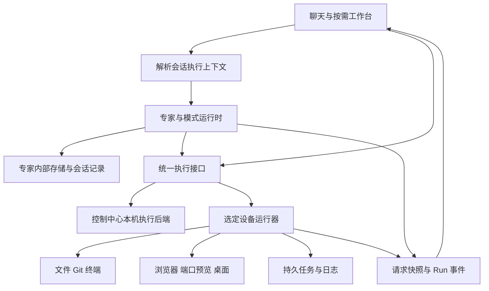

# 自有设备网的统一执行架构与上下文检视

Status: In Progress — 用户已授权开始架构整改；按 revision 3 分链路实施与验收。
Date: 2026-10-14
Revision: 3
Mode: CROSS-CUTTING / ARCHITECTURE
Scope: 用户在当前会话提出的统一整改清单。仓库未发现对应的现存 scope 条目；不另建范围计划。

## Summary

用户明确：这是自己的设备网，日常文件、命令、屏幕查看与控制无需反复询问；工作目录不是共享权限边界。用户要求先列清整改范围、统一设计，并允许必要的架构调整。本修订取代 revision 1 以共享根扩权、设备本机确认窗口和审批收件箱作为默认流程的设计。

目标是云端协调、设备执行、结果可检视的一套系统。专家推理与会话可以在控制中心运行；涉及目标机器资源的操作通过统一执行上下文到对应设备完成。信任、工作目录、模式与任务生命周期分别建模。

本修订在自有受信设备模式下取代 0001/0005 的默认最小共享范围、高危能力强制确认，以及 0008 的桌面接管逐次确认条款。旧协议的受限流程只通过兼容适配器处理。账户归属、原生系统账户身份、设备撤销和结果真实性继续构成执行边界。

## Evidence and diagnosis

| 已检查的入口 | 当前结构与影响 |
| --- | --- |
| infra/devices/protocol.py、service.py、executor.py | permissions/roots/grant_version 是主要授权模型；文件必须 root-relative，命令的 cwd 要有 root，command.run 总进入 pending_confirmation；命令本身按 OS 账户运行，并不被该 root 沙箱化 |
| infra/agents/manager.py、devices/acp_bridge.py | 绑定固定为 device_id + root_id；ACP 需要可写共享根，并硬性拒绝 cwd 之外路径 |
| api/routers/workspace.py、terminal.py | Git 和终端解析控制中心的专家 workspace；聊天设备选择没有统一覆盖这些入口 |
| 已安装 harness 的 agent.py、backends/workspace.py | agent.workspace 同时用于专家内容、技能、引导材料及用户文件；runtime persistence 又依赖本地工作区，不能直接把整个 workspace 换成设备目录 |
| infra/agents/middleware/device_target.py | 当前未提交试验以提示词和隐藏宿主工具表达目标；这不能成为统一执行路由的最终实现 |
| infra/devices/executor.py 的 _command | 普通命令默认 60 秒、上限一小时，结束或取消时清理子进程；不能直接承担持续训练任务 |
| api/routers/skills.py 的 external discovery | 只扫描控制中心 Path.home() 下的 Skill；缺少设备来源与其他可执行能力的统一发现 |
| dashboard 的 utils/workMode.ts | 多数工作模式通过给用户消息加提示实现，尚无完整的后端模式契约 |
| context usage 与 trajectory | 已有最终模型请求的 usage 快照和轨迹基础，但存储、分类、请求关联和统计口径还不足以支持完整检视 |

上述为源码检查结论。上次笔记本真机测试出现确认后 503/离线，根因尚未确定；不得把架构调整本身当成已修复该故障的证据。

## Requirements and acceptance

| ID | 要求与可观察的验收结果 |
| --- | --- |
| AC-01 | 新客户端以用户明确进行的设备账号登录/登记加入自有设备网；浏览器登录不自动登记机器。受信设备的正常文件、命令、桌面查看/控制不再产生逐次审批请求 |
| AC-02 | 信任策略绑定控制中心身份、账户与设备，保存 desired/applied 状态及 revision；重启和升级保留。配置显示成功前须得到设备应用回执；其他控制中心不继承该授权 |
| AC-03 | 一次执行携带不可变 ExecutionContext；API、专家工具、ACP、团队派工、定时任务及工作台都能给出相同的实际设备、OS 账户和工作目录。并发会话不串目标；目标离线时不回退到控制中心执行 |
| AC-04 | 专家内部存储与项目执行工作区分别有正式接口。改变设备或项目目录不移动专家记忆、凭据和会话库；专家读写项目文件时使用目标设备后端 |
| AC-05 | owner 模式接受目标 OS 的绝对路径和相对于 working_dir 的路径；允许 OS 账户正常访问的其他目录与链接，不将默认目录或 places 作为沙箱。路径解析在设备侧完成，真实 OS 权限不足返回明确原因 |
| AC-06 | 专家绑定保存默认设备与可选工作目录。当前会话的明确设备选择优先于专家默认；运行中的任务和已打开的交互会话保留其原目标，并有清楚的设备标签 |
| AC-07 | 文件树、编辑器、搜索、终端、Git/Diff、浏览器和端口预览统一使用项目执行后端。选 GPU 时显示其实际文件/Git/终端；远程服务的 localhost 预览通过该设备会话访问 |
| AC-08 | 受信 Windows 设备的桌面会话无需本机确认即可查看和输入；连续画面、缩放后的坐标、组合键、连接恢复均以实际交互验证。无桌面或不可用的设备报告具体能力状态 |
| AC-09 | 短命令和持久 Job 分开。Job 能启动、查看状态与增量日志、检查进程/资源、取消；关闭浏览器、结束聊天或控制通道重连不停止 Job。设备运行器重启后重新关联仍在运行的 Job；结果不明的请求不自动重放 |
| AC-10 | 外部能力从选定设备发现，标明设备、来源、版本、依赖和可用性。Skill 导入、CLI/ACP 使用与 MCP 配置使用同一能力目录；CLI 登录与设备本地凭据留在执行设备 |
| AC-11 | WorkMode 作为后端持久字段定义执行行为与产物，而不是消息前缀。Agentic 可执行，Plan 只能计划及允许的观察，Debug 有复现/定位/验证过程，Multitask/Team 有真实派工，Cowork 能交接决策，Computer Use 关联设备交互会话，Deep Research 有来源与证据记录 |
| AC-12 | RequestSnapshot 按 agent/thread/turn/request 关联组成、来源引用、估算、提供商实际 usage 与耗时。可展开消息/工具/注入内容、比较请求增量与压缩前后；停止专家或刷新页面后仍能查看历史 |
| AC-13 | 统计分别标明当前/下一请求估算、最近实际请求、累计消耗。缓存字段按提供商归一化，输入总量不重复加缓存；缺失时间/价格/容量显示未知，不能造数 |
| AC-14 | RunEvent 将计划、工具、设备操作、Job、文件修改、Git 快照及请求快照关联到同一 Run。状态来自执行回执；文件恢复有明确目标与范围，不能声称任意命令、训练或系统操作已回滚 |
| AC-15 | 聊天默认保持紧凑：模式、设备、模型入口与发送；工作台和 Context 按需展开。设备页集中管理信任、实际能力、版本、默认位置和运行健康；错误可定位到连接/策略/OS/工具/任务阶段 |
| AC-16 | 新协议与数据模型有明确版本门禁、SQLite/PostgreSQL 成对迁移及旧客户端适配。笔记本、工位、GPU 和云端升级保留 device_id、凭据、已有资料及记录；旧客户端不被界面伪装成支持新架构 |

## Decision / Design

### DEC-01 — 控制中心与设备运行器的职责

复用 Python/FastAPI、现有数据库与设备主动连接，按职责拆分领域服务：

- 控制中心：账户、专家内部存储、模型调用、会话与模式、ExecutionContext 解析、调度及可检视记录。
- 设备运行器：OS 文件操作、命令/Job、PTY、Git、浏览器/端口预览、桌面及设备能力发现。
- 控制中心上的本机执行也通过 LocalExecutionBackend 使用同一接口；device_id 为空不能隐含选择本机。

实施细化（2026-10-15）：本机目标持久化为 `target_kind=local`、`device_id=null`，与未选择的 `target_kind=device`、`device_id=null` 区分。控制中心是多用户服务，本机执行沿用现有宿主工具的管理员权限；普通账户使用自己的已登记设备。每次本机操作重新验证账户与管理员身份，专家/账户默认目标也必须明确保存为 local。不同账户的交互会话与执行状态分别保存。



不引入额外的必需队列服务。数据库保存控制中心记录，设备本地日志/任务存储保存执行事实，连接负责传送与对账。

### DEC-02 — DeviceTrustPolicy

正式策略为 owner 与旧设备兼容的 restricted，而不是继续给 roots 添加特例：

- owner：明确加入的自有设备按其运行账户权限管理。文件读写、命令、桌面与已配置能力直接执行；可在设备设置中持久禁用某类能力，日常不弹确认。
- restricted：旧目录与权限规则由 LegacyDeviceAdapter 承接；在旧客户端升级前保持真实行为。
- capabilities 描述设备的实现与实际可用性；policy 描述该账户对设备的操作许可；working_dir 与 places 描述默认位置与导航。三者不能互相替代。
- 新策略应用需要设备回执。连接握手上报协议、已应用策略 revision、运行账户、实际能力及不可用原因。UI 能区分 desired 与 applied。
- 多控制中心按登记身份隔离；同名用户名、设备名或 IP 不是同一个信任关系。

用户已授权当前云端账户下笔记本、工位、GPU 的 owner 模式整改，部署时通过原身份配置应用，不再额外发起共享/接管确认。系统提权仍使用设备 OS 的实际机制与身份。

### DEC-03 — ExecutionContext 是路由事实

请求入口统一解析并持久化：

```text
ExecutionContext
  context_id, controller_id, owner_user_id
  agent_id, thread_id, turn_id, run_id
  target: local | device(device_id)
  working_dir: native device path
  policy_revision, work_mode
  source: session_selection | expert_default | account_default
```

- 目标优先级：会话明确选择 → 专家默认设备 → 账户明确默认；尚无目标时显示需要选择，不能根据列表顺序推断。
- 开始 Run 时冻结目标；切换选择只影响新 Run。子任务继承父任务上下文，显式跨设备派工创建可见的新上下文并校验账户归属。
- 每次执行验证凭据、设备身份及策略；策略撤销后阻止新操作，对相关运行任务发出停止要求并记录真实结果。
- 已有 Job 的只读状态/日志观察保留原设备、目录与 Run 归属，并重新验证当前有效权限；更改默认目录不会永久切断其回执。新执行及其他操作仍校验原冻结策略 revision，不能借观察接口启动或重放命令。
- 并发复用专家时，目标通过 request-scoped 接口传递，不能修改共享 agent/backend/ACP 实例上的全局目标。
- 工具、HTTP 和工作台访问 ExecutionService 的领域接口；提示词可以解释目标，但不承担授权或路由。

### DEC-04 — AgentStore 与 ProjectWorkspace 分离

引入两个明确的存储角色：

| 角色 | 内容与接口 |
| --- | --- |
| AgentStore | 专家配置、记忆、技能/提示材料、会话与 checkpoint、内部认证；独立管理存储定位 |
| ProjectWorkspace / ExecutionBackend | 目标设备项目文件、目录、搜索、编辑、命令、Git、终端、预览；按 ExecutionContext 解析路径与执行 |

现有本地/对象存储后端继续作为合适的存储实现。用户上传的项目资料带显式目标位置；模型产物带来源设备与路径引用。控制中心临时材料不能冒充目标项目文件。

harness 需要正式支持运行时内部存储与请求级项目后端的分别注入，以及请求快照事件。先验证其现有 BackendProtocol 实例扩展点，再在 harness 源码中补齐缺失接口并发布依赖。不要修改已安装 wheel 作为交付，不用隐藏宿主工具、猴子补丁或提示词作为最终替代。

### DEC-05 — 设备协议 v3 与执行服务

将 v3 协商、策略应用、操作请求、会话流、任务对账分别建模。v1/v2 经 LegacyDeviceAdapter 保留兼容语义，不接收其无法证明支持的 owner/持久 Job 能力。

ExecutionService 按目标选择 LocalExecutionBackend 或 DeviceExecutionBackend，提供 typed operation/result/error：

- fs：list/stat/read/write/edit/mkdir/move/remove/search、分块传输与并发编辑校验。
- exec：短命令执行与独立 Job 生命周期。
- git：仓库发现、状态、分组 diff、历史/分支及有明确范围的文件恢复。
- terminal：有设备标签的 PTY 会话，POSIX PTY / Windows ConPTY。
- browser / preview：设备上的浏览器会话、自动化及指定本地服务的认证转发。
- desktop：会话打开、画面与输入、显示器信息、关闭及重连。
- capabilities / acp：设备能力目录及在该执行上下文中使用的 runner。

路径在目标 OS 解析；不能在云端用 Path.home()/resolve() 展开远程路径。owner 模式下 .. 与符号链接按正常 OS 语义处理；restricted 模式才应用共享范围规则。普通 OS 权限错误、策略禁用、设备离线和能力不支持分别返回。

交互流与日志有独立的会话、序号、背压及取消语义，避免大画面/输出阻塞心跳。完整画面、文件块、设备凭据不写入普通操作账本或模型上下文。

### DEC-06 — Job 生命周期独立于连接

设备上的 JobSupervisor 管理任务；连接客户端只提交、观察、取消与对账。

- 短命令保留明确超时、输出限制与取消语义。
- 持久 Job 使用独立 job_id、启动幂等键、进程身份、原始执行上下文、日志序号和持久状态。
- Job runner 与 WS 连接生命周期分开；控制通道/聊天断开不会清理 Job 的子进程。
- 重启运行器后通过 job_id + 进程创建身份重新关联，不凭一个 PID 判定，不自动再次运行旧命令。
- 日志在设备保存并增量读取；向模型只注入明确选取的摘要/范围。资源指标按设备可用采集器报告。
- 状态包含 queued/running/completed/failed/cancelled/interrupted/unknown；控制中心记录最后观察时间，离线不是成功。取消必须取得真实回执。

复用现有 operations 账本承载操作记录，增加 job/session 引用；不要把全部旧短命令偷偷改成脱离管理的后台进程。

### DEC-07 — 统一可检视事件与正式工作模式

Run 记录关联计划、工具调用、设备回执、任务、文件修改、Git 快照和模型 RequestSnapshot。复用 trajectory 的存储/投影基础，补充正式关联字段和事件契约；展示层从同一记录取得状态。

WorkMode 在后端持久化，控制编排、观察/修改策略与产物。设备 trust 与工作模式是独立维度：owner 信任不让 Plan 变成执行模式；Cowork 的任务决策也不变成重复设备授权。各模式有可验证行为，能力不足明确显示。

RequestSnapshot 在最终出站请求捕获，按 request_id 关联响应 usage、缓存、首 token/生成/工具耗时与压缩事件。保存组成与受控内容引用，支持历史与请求比较。估算和实际分别保存；累计账单与单请求容量分别展示；在提供商适配器层定义输入/缓存口径。

#### Revision 3 — WorkMode 的可执行契约（AC-11/14）

本修订细化既有模式要求，不扩大整改范围。删除前端消息前缀；后端按 agent/thread/run 保存 workflow RunEvent，包含 mode、version、顺序阶段与报告。阶段说明是专家提交的报告；已完成工具、设备回执和来源 URL 是独立证据，不把报告文字当作执行成功。`work_step` 通过乐观版本校验推进阶段，拒绝跳步、跨 Run/账户的证据和没有真实派工的并行完成。无产物或证据时可记录 blocked/needs_input，不伪造完成。

| 模式 | 顺序阶段 | 完成证据与执行约束 |
| --- | --- | --- |
| Agentic | execute → verify | 正常执行；报告执行结果与核验 |
| Ask | answer | 既有只读工具策略 |
| Plan | explore → plan | 既有只读策略与内部计划文件；完成计划阶段须引用实际计划产物回执 |
| Debug | reproduce → diagnose → fix → verify | 复现允许失败回执；定位须引用观察；定位前禁止项目修改；验证引用修复阶段之后的执行/观察回执 |
| Multitask | decompose → dispatch → integrate | dispatch 须至少两个真实完成的子任务回执；接受提交不算完成 |
| Team | decompose → dispatch → integrate | dispatch 须至少一个真实完成的专家派工回执；无派工能力则显示受阻 |
| Cowork | work → handoff | handoff 保存问题、推荐项和可选项作为待用户决策产物；它不触发设备授权。决定通过已认证 API/界面记录，不能由模型冒充用户选择 |
| Computer Use | observe → interact → verify | 交互阶段引用实际设备桌面/浏览器会话回执；不存在能力时记录受阻 |
| Deep Research | collect → compare → synthesize | collect/compare 引用实际获取的来源，至少两个不同 URL；报告保留来源链接、证据说明和事实/推断区别 |

阶段契约由领域服务校验；模型中间件只展示当前状态、工具能力缺口与使用说明。模型自然语言结束不会自动将 workflow 标成完成。工作台复用运行记录区域展示阶段、报告、证据和交接决定，聊天不增加常驻面板。子任务继承 work_mode 和冻结目标，但各自使用独立 agent/thread 的运行记录；派工的父记录保存 job_id、目标专家和真实最终状态。

### DEC-08 — 工作台与能力目录

- 工作台 tab 保存 context_id / target / working_dir / interaction session 引用，标题显示设备；会话切换不悄悄重绑已有终端/桌面。
- 当前会话可明确打开其他设备的面板用于比较，但显示对应目标。
- 外部能力发现由设备执行，返回来源设备、类型、内容摘要/版本、依赖状态及可用原因。导入 Skill 是用户选择专家行为的动作，不是额外的设备操作授权。
- 设备信任、默认位置、能力、版本、连接/运行健康集中在设备页；聊天保留紧凑入口，详情在工作台与 Context 中按需查看。

设备浏览器使用设备上的 Playwright/Chromium，通过既有认证执行连接传送受限大小的画面与输入。预览 URL 的 localhost 在设备浏览器解析，页面资源与 WebSocket 均由该设备访问；不把第三方 HTML 放进控制中心同源 iframe。浏览器缺少依赖或可执行文件时返回具体缺口，不能退回控制中心浏览器。设备构建包含 Playwright 及其锁定依赖，浏览器二进制复用设备现有 Chromium/Chrome/Edge 或显式安装的 Playwright Chromium。

同一 owner/agent/thread 的浏览器会话可在后续 Run 与工作台重连，认证 lane 由 ExecutionService 生成，模型和客户端不能指定另一个专家的 lane。已打开 tab 冻结设备；每次新操作仍验证策略 revision。浏览器 cookie/profile 留在登记控制中心对应的设备私有状态目录。画面拉取单次不超过 512 KiB，最多一个未完成拉取；输入失败显示结果未知并停止排队，禁止自动重放。普通账本只留操作/会话摘要，不写屏幕、DOM、键入内容或 JS。

## Data and API impact

1. 控制中心增加策略 desired/applied revision、能力/运行账户/协议状态；专家绑定拆为默认设备与默认工作目录；会话/Run 保存 ExecutionContext。
2. 增加 Job/session 引用与 RequestSnapshot/RunEvent 的关联字段；所有资源仍由既有 owner/agent/thread 约束。
3. 新增 v3 执行/会话/Job API；旧 device operations、root-relative 文件 API、ACP 和 workspace API 通过明确适配器迁移，避免多套业务规则并行演化。
4. SQLite/PostgreSQL 使用对应的下一次迁移。设备端任务持久化与控制中心 DB 分离；迁移先备份并保留旧身份，不复制另一控制中心的授权或模型凭据。

## Build plan and verification gates

| 顺序 | 实施范围 | 对应 AC | 必须取得的证据 |
| --- | --- | --- | --- |
| 0 | harness 存储/执行接口、v3 协议、Windows PTY/交互流三个技术验证；形成接口契约 | 03/04/07/08/12/16 | 双设备并发不串目标、专家内部资料定位不变、最小原生会话可往返；不能用功能降级冒充通过 |
| 1 | DeviceTrustPolicy、执行上下文、协议协商与本机/设备执行接口 | 01–06/16 | 原身份应用 owner；跨账户/其他控制中心拒绝；绝对路径、默认 cwd、并发目标和重启验证 |
| 2 | 文件/命令/ACP 纵向打通与桌面实际接管；根因修复离线故障 | 03–06/08 | GPU 实际目录/命令结果；Windows 无确认查看+键鼠输入；稳定连接且明确故障原因 |
| 3 | JobSupervisor、持久日志、资源观察、取消与重连对账 | 09/14 | 无重负载的持续任务跨断连/运行器重启继续观察；重复提交不重跑；停止有进程级证据 |
| 4 | 工作台远程文件/终端/Git/浏览器/预览统一 | 07/15 | 同一设备仓库的编辑与 diff、同机终端 pwd、设备 localhost 服务预览；tab 切换不串目标 |
| 5 | 正式模式、能力目录与持久 RequestSnapshot/RunEvent | 10–14 | 各模式行为、设备来源、真实请求/缓存与压缩对比；刷新/停止专家后历史保留 |
| 6 | 紧凑 UI、旧设备迁移、独立评审与发布升级 | 15/16 + 全部 | Linux/Windows CI、相关 make all、真实 UI 和三台设备验收；云端升级保留资料与身份 |

技术验证用于决定适配器实现与依赖版本，不能替代最终产品验收。所有 AC 当前均未按 revision 2 验证；revision 1 的测试通过只证明旧试验行为，不能证明本方案完成。

## Consequences / follow-up

- 这是执行架构整改，涉及 harness 接口、设备协议、持久模型、调用入口和工作台。
- 先冻结上述正式接口，再按纵向链路实现。单一执行服务与事件契约减少各页面、工具重复处理权限/路径/状态。
- 已有未提交的确认窗口/审批收件箱、目标提示 middleware 等按新职责逐项评估，不能因为已经写好就保留在默认主路径。
- 旧规格和 device-network-contract/device-acp/configuration-ownership/architecture 文档需在方案确认及实现时同步修订；本 Proposed 修订先记录覆盖关系，不将旧文档当作新模式的验收标准。
- 尚待技术验证：harness 公开接口的具体改动与依赖发布；Windows ConPTY 交付；设备浏览器与流通道的连接实现。它们不是新增的用户授权问题。
- 用户于本修订完成后明确要求“开始改架构”；开始实施，完成后按既有授权进行评审、发布与设备升级。

## References

- [账号设备网](0001-account-device-network.md)、[权限管理](0005-device-permission-management.md)、[桌面接管](0008-desktop-handoff-failover.md)。
- [设备网合同](../octopus/device-network-contract.md)、[配置归属](../octopus/configuration-ownership.md)、[当前架构](../architecture.md)。
- [发布流程](../octopus/release-process.md)。
- [dsh-context](https://github.com/bowenliang123/dsh-context)：用户指定的上下文检视参考；本规格定义 Octopus 自身的数据与事件契约。
