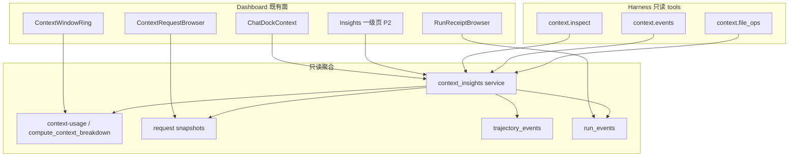

# 0020 Context Insights：补齐既有面板 + Harness 只读自查工具

- Spec ID: `0020-context-insights-and-harness-tools`
- Status: **Ready**（Ready；本 PR 实现 MVP S0–S4）
- Revision: `2026-10-16.2`
- Date: 2026-10-16
- Mode: PRODUCT / DESIGN（Enhance existing；禁止平行新造面板）
- Authoritative path: `docs/specs/0020-context-insights-and-harness-tools.md`
- Code baseline: `CkEFFAF/Octopus-public` @ `40492e2b`（工作区 `D:\Agent_Workspace\octopus\Octopus-public`）
- Reference: [bowenliang123/dsh-context](https://github.com/bowenliang123/dsh-context)（README / v0.72 能力面；**非** npm 插件宿主，能力进 Dashboard 一等公民）

---

## Goal

在 **GPT 已落地的 Context 面板**上补齐到与 dsh-context **同级**的详细洞察体验，并 **额外**提供只读 Agent 工具，让 Harness / 专家可自查上下文、为自优化提供洞察（压缩/剪枝仍走既有 harness 能力 + 用户确认，工具本身不静默删证据）。

基调：**Enhance existing**，复用 `ChatDockContext` / `ContextWindowRing` / `ContextRequestBrowser` / trajectory / request snapshots / run_events；**禁止**另起平行「Context Insights 2」面板或第二套统计口径。

## Non-goals

- 不做独立 npm / dsh 插件形态。
- 不精确复刻 models.dev 全量计价 / DeepSeek 峰谷价（P2 可粗估或延后）。
- 不新增全局 System Prompt prefix/suffix 注入（与 persona/rules 重叠；映射到既有设置或延后）。
- 不解析 PTC `run_code` 嵌套 File Activity（若无等价调用链则延后）。
- 不改变 work_step / 证据校验记账语义；Insights **只消费**已落库数据。
- MVP S0–S4 由 feature/0020-context-insights 实现；不升 hub / 不改 work_mode 证据校验。

---

## DEC（设计决议）

| ID | 决议 |
| --- | --- |
| DEC-01 | 能力进 **Octopus Dashboard 一等公民**（右栏 dock `kind: context` + 后续 Insights 一级页），不做插件包。 |
| DEC-02 | **单一只读 Context Insights 聚合 API 层**；UI 与 Agent tools **共用**，避免两套统计。 |
| DEC-03 | 与官方 meter **同数**：Current / Ring 必须走 `compute_context_breakdown` / `octopThreadsApi.contextUsage`（与 `ContextWindowRing` 同源）。 |
| DEC-04 | Agent 工具 **只读洞察**；真正 compact/prune 调用既有 harness compaction / 用户确认动作；禁止 Agent 静默删证据或改 receipt。 |
| DEC-05 | 证据校验铁律：只聚合已落库 `run_events` / receipts / request_snapshots；字段缺失标缺口，**不伪造**；不改 `work_mode` 证据白名单。 |
| DEC-06 | MVP = **在现有 `ChatDockContext` 面上补最缺**（Trend 模式、Events 规范化、Browser UX 铁律、3 个只读 tools）；Insights 跨会话页 / Fleet / 成本为 P2。 |

---

## 1. 产品能力对照表（三列：现有 / 缺 / Agent 工具）

> 列说明：**现有 GPT 面板已有** = main 上已可点到；**缺** = 要对齐 dsh 或 Octopus 增强但仍缺；**要新建 agent 工具** = dsh-context **没有**向模型暴露查询工具，属 Octopus 增强（写「是/否/延后」）。

### 1.1 五面入口

| dsh-context 能力 | 现有 GPT 面板已有 | 缺 | 要新建 agent 工具 |
| --- | --- | --- | --- |
| Context Insights 一级侧栏页（KPI / 7 日图 / 热力 / 聚合 Composition / 可筛 session 卡） | 无独立一级页 | P2：`WorkspaceNav` 一级「上下文洞察」；按专家/房间/设备筛（增强于 dsh 的 workspace-group） | 延后（跨会话聚合 API 后再暴露 `context.insights`） |
| 会话内 Context tab（Stats / Token / Timing / Current / Trend / Browser / Events / File Activity） | **有**：右栏 dock `kind: "context"` → `ChatDockContext`（Stats + Current + 粗 Trend + Request Browser + Trajectory 事件列表 + RunReceipt） | Token/Timing 拆卡细化；Trend Total\|Delta + Step\|Turn；Events 独立卡规范化；File Activity 卡 | 是：`context.inspect` 覆盖 Stats/Current/Trend 摘要 |
| Fleet / Agent Network 活卡片 | 无 Fleet tab；团队有 `default_target` / `model_ref` 只读 enrichment（0019 / `target_visibility`） | P2：Fleet 卡（当前 + parents + subagents / 群聊成员）叠 context 占用 + device/model | 延后：`context.fleet`（P2） |
| Context panel 右栏（同 dashboard + network） | **有**：即 dock Context；与 chat 并列 | 嵌入 mini Fleet；Preferences 控制默认打开 | 否（UI） |
| `/context` slash → 模态组成 + browser | slash catalog 仅有 status 文案片段，**无** Composition 模态 | P1：`/context` 打开与 dock 同源的 slim modal | 否（可复用同一 API） |
| Preferences（放置、趋势粒度、File Activity 排序、system prefix/suffix） | 无专用 Context 偏好 | P1–P2：趋势默认粒度/模式、面板默认开；**延后** prefix/suffix | 否 |

### 1.2 会话内卡片细节

| dsh 卡片/细节 | 现有 GPT 面板已有 | 缺 | 要新建 agent 工具 |
| --- | --- | --- | --- |
| Context Stats（turns/steps/human/tools + cost） | turns/steps/input/output/cache/modelTime（`trajectoryApi.metrics`） | human inputs / live tool calls 计数；成本粗估 P2 | `context.inspect` → stats |
| Token Stats（组成环 + provider output + cache） | Current 段条 + Ring；provider actual 在 Request Browser | 独立 Token 卡与 Stats 并列；环与 composer **强制同数**回归测 | 含于 `context.inspect` |
| Timing Stats | llm_duration / ttft 等部分在 metrics | tool vs model vs overhead 拆分展示 | 延后或 inspect.timing |
| Current Context 六色堆叠 + compaction reserve | **有** 七段色条（SEGMENT_KEYS）；无 hatched reserve | 映射说明 UI；compaction reserve 帽；user/assistant/tool_results 细分（见 §2） | `context.inspect` → breakdown_now |
| Context Trend：Step\|Turn、Total\|Delta、Step brief、✂ Compact/Prune、Overview ribbon | **有** 粗柱（按 trajectory 含 `input_tokens` 的事件）；可点选 | **P0 缺口**：Total\|Delta、Step\|Turn、✂ 标记、Step brief、Overview、与 Browser 联动 | `context.inspect` → trend 摘要 |
| Context Browser：Live、assembled 元素、tool source chips、assistant kind filter、Raw/MD、附件卡、vs previous diff | **有** `ContextRequestBrowser`：request 列表、composition、components、delta、transformation（summarization）、actual_usage | Live 明确入口文案；assistant kind chips；tool source chips 完善；附件卡；slim head + 按需 detail | `context.inspect` detail 可选；完整 assembled 走 API 已有 requests |
| Context Events：inject/compact/prune/switch/mode | Trajectory kinds：`user/assistant/tool/context/compacted/system`；filter 含 compacted；RunEvent 另有 model/device/job/workflow | **规范化** Events 卡：映射 inject/compact/prune/model/mode；与 RunEvent/work_mode 变更合并时间线 | **是**：`context.events` |
| File Activity：read/write/search + 行 delta | RunReceipt / device 文件类 run_events 可间接看；无聚合卡 | **P1**：按 path 聚合 read/write/search + 行 delta；点回 Browser/Receipt | **是**：`context.file_ops` |
| Fleet 家族肖像、占用、跳转 | 无 | P2 + 0019 成员 default_target/model_ref | 延后 |

### 1.3 Octopus 相对 dsh 的增强（对照表必列）

| 增强项 | 现有 | 缺 | Agent 工具 |
| --- | --- | --- | --- |
| hub/device 执行目标 + work_mode 叠进 Context | dock tab 可显示 device_id/working_dir；ExecutionContext 已有 | Current/Stats 旁显示 target_kind/device/busy/work_mode | inspect 返回 execution 摘要 |
| AgentTeams / 群聊：成员 context 占用 + default_target + model_ref | `target_visibility.visible_expert_defaults` / agent_list enrichment | Fleet/团队检视 UI；成员占用需 per-member breakdown | P2 fleet |
| RunEvent / receipts / work_step 证据链进 Browser/Events | `RunReceiptBrowser` + run-events API | Events 与 Receipt 深度联动；**只读**，不改校验 | events / file_ops 只读 |
| agent-native 配置变更进 Events | 0016 native tools 写配置；轨迹未必记 | P1：配置变更 → trajectory/run_event kind 映射进 Events | events 可读到则返回 |
| 跨会话 Insights 按专家/房间/设备筛 | 无 | P2 Insights 页 | 延后 |

### 1.4 明确延后

| 项 | 原因 |
| --- | --- |
| models.dev / DeepSeek 峰谷精确计价 | 可用粗估或 P2+；非 MVP |
| System prompt prefix/suffix 全局注入 | 与 persona/rules 重叠 |
| PTC run_code 嵌套 File Activity | 本仓无等价嵌套解析时不做 |

**对照计量（约）**：对齐已有 ~10 项；缺口/待补 ~18 项；延后 ~3 项；新建 agent 工具 MVP 3 个（inspect/events/file_ops），P2+ 再加 insights/fleet。

---

## 2. 数据源与缺口

### 2.1 数据模型映射（dsh → Octopus）

| dsh 概念 | Octopus 映射 |
| --- | --- |
| Session | `thread`（`agent_id` + `thread_id`） |
| Host durable event → projections | `trajectory_events` + projector；UI 投影 = Stats/Trend/Events |
| 官方 meter 同数 | `octop_harness.context_usage` / `compute_context_breakdown` → `GET .../context-usage` |
| event log | `RunEventRepo`（run_events）+ `trajectory_events` |
| projection / assembled request | `RequestSnapshotRepo` + `execution/inspection.py` → `GET .../requests` |
| Fleet | AgentTeams / subagents / `device_context` / `target_visibility` |
| File Activity | 设备/工作区文件类 run_events + tool 结果（read/write/search）；**证据只读** |

### 2.2 组成分段映射（dsh 7 类 ↔ SEGMENT_KEYS）

本仓 SoT（fallback）：

`system_prompt | tool_definitions | rules | skills | mcp | subagent_definitions | conversation`

（优先 `octop_harness.context_usage.SEGMENT_KEYS`）

| dsh 7 类 | Octopus SEGMENT_KEYS | 缺口 |
| --- | --- | --- |
| system | `system_prompt` | 基本对齐 |
| tools | `tool_definitions`（+ 可选展示 `mcp` 为 tool 源） | MCP 在 dsh 常进 tools；本仓独立段——UI legend 保留独立色，Browser source chip 标 `mcp:` |
| user | ⊆ `conversation` | **缺口**：conversation 未拆 user/assistant/tool_results |
| inject | `rules` + `subagent_definitions`（+ 部分 turn_context 注入） | 命名不同；Events 需标 producer |
| skill | `skills` | 对齐 |
| assistant | ⊆ `conversation` | 同 user，缺拆分 |
| tool（tool results） | ⊆ `conversation` | 同左；RequestSnapshot `components[].kind` 可辅助 Browser |

**P0 策略**：Ring/Current **继续用 SEGMENT_KEYS 同数**；Browser 用 request `components` / `composition` 展示更细 kind。**P1+** 评估 harness 是否可输出 conversation 子分段；未就绪前 UI 不伪造拆分。

### 2.3 现有可抽字段

| 源 | 符号 / 路径 | 可抽 |
| --- | --- | --- |
| Context breakdown | `src/octop/infra/agents/threads/context_breakdown.py` → `compute_context_breakdown`, `SEGMENT_KEYS`, `usage_dict_from_message` | max/used/segments |
| context-usage API | `src/octop/api/routers/chat/history.py` `GET .../context-usage` | 同上 |
| Request snapshots | `src/octop/infra/execution/inspection.py`, `src/octop/infra/db/repos/request_snapshots.py`, `api/routers/chat/inspection.py` | components、composition、actual_usage、transformation、delta |
| Run events | `src/octop/infra/db/repos/run_events.py` `RunEventRepo.save/list`；`infra/execution/events.py` | kind=interaction/device/job/model/…；payload；context_id |
| Trajectory | `infra/db/repos/trajectory_events.py`；`infra/history/trajectory/*`；`turn_context.py` | kinds、metrics、inject 合成 chunk |
| Work mode / 证据 | `infra/execution/work_mode.py` | workflow/work_step；**Insights 只读，不改白名单** |
| Teams | `infra/agents/teams/device_context.py`, `target_visibility.py` | default_target、model_ref |
| Native tools 骨架 | `infra/agents/native_management_tools.py` | 注册新只读 tools 的扩展点 |
| Dashboard API | `dashboard/src/api/modules/octopThreads.ts` `contextUsage`；`execution.ts` requests/runs；`trajectory.ts` | 前端已接 |

### 2.4 缺口表（Top + 其余）

| # | 缺口 | 影响 | 建议阶段 |
| --- | --- | --- | --- |
| G1 | Trend 无 Total\|Delta / Step\|Turn / ✂ / Step brief | 难看出压缩与增长故事 | **P0** |
| G2 | conversation 未拆 user/assistant/tool_results | Current 无法六色完全对齐 dsh | P1（依赖 harness） |
| G3 | 无 File Activity 聚合投影 | 文件读写不可按 path 总览 | **P1** + `context.file_ops` |
| G4 | Events 未统一 inject/compact/prune/model/mode 词汇 | 与 dsh Events 芯片不一致 | P0 映射层 / P1 补记 |
| G5 | 无跨会话 Insights 聚合表 | 无法 KPI/热力 | P2 |
| G6 | 无 compaction reserve 显式字段 | Current 无 hatched 尾 | P1（harness 或估算） |
| G7 | agent-native 配置变更未必进轨迹 | Events 缺配置故事 | P1 |
| G8 | 无共享 BFF 聚合层 | UI 与 tools 易双口径 | **P0** 建只读 service |

**数据缺口 Top3（回报用）**：G1 Trend 语义、G3 File Activity 聚合、G2 conversation 子分段。

---

## 3. UI 信息架构（扩展既有，不平行新造）

### 3.1 现有入口（必须复用）

```
Chat 右栏 ChatDockPanel
  └─ dock tab kind: "context"
       └─ ChatDockContext
            ├─ ContextRequestBrowser   # assembled request / delta / transformation
            ├─ RunReceiptBrowser       # run receipts → 可跳 request
            ├─ Stats 条
            ├─ Current（SEGMENT 色条）
            ├─ Trend（粗柱）
            └─ 「Browser」区（实为 Trajectory 事件列表 + kind filter）
Composer 旁 ContextWindowRing → octopThreadsApi.contextUsage
```

关键文件见 Relates。

### 3.2 目标 IA（在同一面板内重组/增强）

| 区域 | 行为 | 阶段 |
| --- | --- | --- |
| Stats | 保留；补 human/tool 计数；链到 Fleet 入口（P2） | P0 小补 |
| Current | 同数 Ring；legend；注明 SEGMENT↔dsh 映射；P1 reserve | P0 |
| Trend | 切换 Total\|Delta、Step\|Turn；✂ 钉在 compact/prune；hover ↔ Browser | **P0** |
| Browser | 以 `ContextRequestBrowser` 为唯一 assembled 浏览；Live + vs previous；slim head + 展开 detail | P0 UX / P1 chips |
| Events | 从现「伪 Browser」事件列表升格为独立 **Events** 卡；芯片 Inject/Compact/Prune/Switch/Mode | P0 映射 + P1 |
| File Activity | 新卡，数据来自聚合 API；点 path → Receipt/Browser | P1 |
| Receipts | 保留 `RunReceiptBrowser`，作为证据入口 | 已有 |
| Fleet | 会话内子 tab 或 Current 旁网络条 | P2 |
| Insights 页 | 侧栏一级；跨 thread KPI | P2 |
| `/context` | slash → Modal 复用 Current+Browser 组件 | P1 |
| Preferences | 趋势默认、面板默认开 | P1–P2 |

### 3.3 UX 铁律（必抄 dsh）

1. **与官方 meter 同数**（DEC-03）。
2. Trend：**Total | Delta** + **Step | Turn**。
3. Browser：**Live** + **vs previous delta**。
4. 压缩事件 **✂** 标记在 Trend。
5. **slim head + 按需 detail**（列表/摘要默认；展开再拉 `requests/{id}` / `trajectory/event`）。

---

## 4. Agent 工具契约（只读为主；Octopus 增强）

> dsh-context **无**模型侧查询工具。下列工具挂到 `native_management_tools`（或并行只读 catalog），**权限：当前 session 的 agent/thread 所有者**；跨专家需显式 target 且 ACL 与 `octop_thread_read` 同级。

### 4.1 共享聚合层

建议新建（实现阶段）：`src/octop/infra/context_insights/service.py`（名可调）

- 输入：owner, agent_id, thread_id, 可选 filters
- 输出：与 Dashboard 相同的 DTO（stats / breakdown / trend_points / events / file_ops）
- Router：薄封装 `GET /agents/{id}/threads/{tid}/context-insights/...` **或** 先复用现有 endpoints，由 tools 直接调 service（P0 最小：tools 调现有 repo/service，P1 再收口单一 BFF）

### 4.2 MVP 工具

#### `context.inspect`

| 项 | 约定 |
| --- | --- |
| 目的 | 自查当前窗口占用、分段、粗趋势、执行目标摘要 |
| 参数 | `thread_id?: str`（默认当前）；`include?: ("stats"|"breakdown"|"trend"|"execution")[]`；`trend_limit?: int`（默认 20） |
| 返回 | `{ stats, breakdown: {max,used,segments}, trend: [{seq,input_tokens,kind_marks}], execution?: {target_kind,device_id,working_dir,work_mode}, meter_source: "context_usage" }` |
| 权限 | 只读；本 agent 或 ACL 允许的 thread |
| 禁止 | 触发 compact；改消息；写 run_event |

#### `context.events`

| 项 | 约定 |
| --- | --- |
| 目的 | 列出窗口变化事件（映射后的 inject/compact/prune/model/mode + 原始 kind） |
| 参数 | `thread_id?`；`kinds?: string[]`；`before_seq?`；`limit?`（默认 50，max 100） |
| 返回 | `{ events: [{event_id, seq, ts, mapped_kind, raw_kind, summary, token_delta?, producer?}], has_more }` |
| 权限 | 只读；同 inspect |
| 禁止 | 删除/改写事件 |

#### `context.file_ops`

| 项 | 约定 |
| --- | --- |
| 目的 | 文件活动摘要（read/write/search 聚合） |
| 参数 | `thread_id?`；`upto_request_seq?`；`path_prefix?`；`limit?` |
| 返回 | `{ files: [{path, reads, writes, searches, lines_added?, lines_removed?}], truncated: bool }`；字段缺失则省略并 `gaps: string[]` |
| 权限 | 只读；**不**返回文件正文（仅路径与计数）；正文走既有 workspace/device 读工具且受权限约束 |
| 禁止 | 当作删改文件接口 |

### 4.3 自优化边界

| 允许 | 禁止 |
| --- | --- |
| 工具返回「建议：窗口占用 >80%，最近有 ✂ compact」 | 工具内直接 prune/删消息/改 receipt |
| UI「建议卡」→ 用户确认 → 调既有 compact | Agent 静默调用破坏证据链的写操作 |
| P3 只读建议卡 | P0–P2 写路径 |

### 4.4 命名别名（实现可选）

文档主名：`context.inspect` / `context.events` / `context.file_ops`。  
若需与早期草案对齐，可实现别名：`context_stats`≈inspect.stats，`context_breakdown_now`≈inspect.breakdown，`context_trend`≈inspect.trend，`list_context_events`≈events，`file_activity_summary`≈file_ops——**同一 service，禁止两套逻辑**。

---

## 5. 模块边界与分期

### 5.1 边界图



**扩展点（Coder 改这里，勿新造平行面板）**

| 层 | 路径 | 扩展方式 |
| --- | --- | --- |
| Dock 面板 | `dashboard/src/pages/Chat/components/ChatDockContext.tsx` | 增强 Trend/Events/File Activity 分区 |
| Request Browser | `.../ContextRequestBrowser.tsx` | Live/delta/slim detail UX |
| Ring | `.../ContextWindowRing.tsx` | 保持同数；可复用 legend |
| Dock 注册 | `.../ChatDockPanel.tsx`, `hooks/useChatDockPanel.ts` | 已有 `kind: context`；P2 可加 fleet 子视图 |
| API 模块 | `dashboard/src/api/modules/{octopThreads,execution,trajectory}.ts` | 增 insights 客户端或复用 |
| Breakdown | `src/octop/infra/agents/threads/context_breakdown.py` | 只读消费 |
| Inspection | `src/octop/infra/execution/inspection.py`, `api/routers/chat/inspection.py` | 已有 requests/run-events |
| Tools | `src/octop/infra/agents/native_management_tools.py` | 注册 3 只读 tools |
| i18n | `dashboard/src/locales/{zh,en}.json` `chat.contextInspect.*` | 补文案 |

### 5.2 分期勾选切片（给 Coder）

#### MVP / P0 — 现有面上补最缺

- [x] **S0** 固化「同数」回归：Ring / Current / context.inspect.breakdown 三处断言同源
  - Checklist：Ring + Current → `octopThreadsApi.contextUsage` → `GET .../context-usage` → `compute_context_breakdown`；`context.inspect` → `ContextInsightsService._breakdown` → 同一函数；`meter_source == "context_usage"`；单测见 `tests/unit/context_insights/test_service.py`
- [x] **S1** Trend：Total\|Delta + Step\|Turn + ✂（compacted/transformation）+ 与 Browser 选中联动
- [x] **S2** Events 卡：mapped_kind 芯片；复用 trajectory；去掉「假 Browser」命名混淆
  - **P1 gap（诚实）**：`map_event_kind(source="run_event")` 已就绪，但 `ContextInsightsService.events` 仍只分页 trajectory，尚未把 run_events（model/device/workflow）合入 Events 流
- [x] **S3** Browser UX：Live 标识、vs previous（列表摘要）、slim head；**选中不 eager 拉全量 detail**，展开组件明细时才 `executionApi.request`
- [x] **S4** 只读 tools ×3：`context.inspect` / `context.events` / `context.file_ops`（file_ops 可先返回 gaps 若聚合未就绪）
- [x] **S5** 文档/i18n：SEGMENT↔dsh 映射说明

#### P1

- [ ] File Activity 聚合卡 + file_ops 完整计数
- [ ] `/context` slash modal（复用组件）
- [ ] assistant kind / tool source chips；附件卡
- [ ] Preferences：趋势默认粒度/模式
- [ ] 配置变更 → Events（衔接 0016）

#### P2

- [ ] Insights 跨会话页（专家/房间/设备筛）
- [ ] Fleet / 团队编队 + hub/device/work_mode 叠层
- [ ] 成本粗估

#### P3

- [ ] 只读自优化建议卡 → 用户确认后触发既有 compact

---

## 6. 风险与证据校验影响

| 风险 | 缓解 |
| --- | --- |
| 双口径统计（UI 一套、tool 一套） | DEC-02 单一 service |
| 伪造 conversation 子分段 | 缺口标 G2；不编造 |
| Agent 借 file_ops 读私货 | 只返回 path/计数；正文走原权限工具 |
| Insights 误改 work_step / 证据白名单 | DEC-05；只 SELECT；评审禁止碰 `WorkModeService` 校验逻辑 |
| Trend ✂ 误标 | 仅 `compacted` / `transformation.kind` / 明确 prune 事件 |
| 大量拉 components 拖垮面板 | slim head + 分页 + 既有 `components_truncated` |
| 与 0015 AC-12/13/14 冲突 | 对齐：估算与 actual 分列；缺失显未知 |

**对证据校验**：零语义变更。若 receipt 缺字段 → `gaps[]` / UI「未知」，禁止补假 evidence_id。

---

## Relates（精确路径）

### Specs

- `docs/specs/0015-device-execution-and-context-inspection.md`（AC-12/13/14 RequestSnapshot / 统计 / RunEvent；Context 扩展方向）
- `docs/specs/0016-agent-native-configuration.md`（native tools 扩展点；配置变更事件）
- `docs/specs/0019-device-target-defaults-and-session-unify.md`（default_target / model_ref / 会话统一目标）
- `docs/specs/0018-agent-self-schedule-reminder.md`（可选：长任务自检可消费 context.inspect）

### Backend

- `src/octop/infra/agents/threads/context_breakdown.py` — `compute_context_breakdown`, `SEGMENT_KEYS`, `usage_dict_from_message`
- `src/octop/api/routers/chat/history.py` — `GET .../context-usage`
- `src/octop/api/routers/chat/inspection.py` — requests / run-events
- `src/octop/infra/execution/inspection.py` — RequestSnapshot 读写
- `src/octop/infra/db/repos/request_snapshots.py`
- `src/octop/infra/db/repos/run_events.py` — `RunEventRepo`
- `src/octop/infra/db/repos/trajectory_events.py`
- `src/octop/infra/history/trajectory/turn_context.py`
- `src/octop/infra/history/trajectory/types.py` — `TrajectoryKind`
- `src/octop/infra/execution/events.py`
- `src/octop/infra/execution/work_mode.py` — 证据校验（只读旁路）
- `src/octop/infra/agents/teams/device_context.py`
- `src/octop/infra/agents/teams/target_visibility.py`
- `src/octop/infra/agents/native_management_tools.py`

### Dashboard（既有面板）

- `dashboard/src/pages/Chat/components/ChatDockContext.tsx` — **主面板**
- `dashboard/src/pages/Chat/components/ChatDockContext.module.less`
- `dashboard/src/pages/Chat/components/ContextRequestBrowser.tsx`
- `dashboard/src/pages/Chat/components/ContextWindowRing.tsx`
- `dashboard/src/pages/Chat/components/ContextChip.tsx`
- `dashboard/src/pages/Chat/components/RunReceiptBrowser.tsx`
- `dashboard/src/pages/Chat/components/ChatDockPanel.tsx`
- `dashboard/src/pages/Chat/hooks/useChatDockPanel.ts` — `kind: "context"`
- `dashboard/src/pages/Chat/hooks/useChatContextWindow.ts`（及测试）
- `dashboard/src/api/modules/octopThreads.ts` — `ContextUsageSegmentKey`, `contextUsage`
- `dashboard/src/api/modules/execution.ts` — `RequestSnapshot`, `RunEvent`, requests/runs
- `dashboard/src/api/modules/trajectory.ts` — metrics/history/event
- `dashboard/src/locales/zh.json` / `en.json` — `chat.contextInspect.*`, `chat.contextWindow.segments.*`

### 参考外仓

- https://github.com/bowenliang123/dsh-context（能力面 / UX 铁律）

---

## Evolution

| Rev | 说明 |
| --- | --- |
| `2026-10-16.1` | 首版 Ready：Enhance existing；三列对照表；数据映射；UI IA；tools 契约；分期；证据风险。基线 `40492e2b`。 |

---

## 验收（设计层）

- [x] Status = Ready；只设计不写业务代码
- [x] 五块齐全：对照表 / 数据源 / UI / Agent 工具 / 边界·分期·风险
- [x] 对照表含 **现有 / 缺 / 要新建 agent 工具**
- [x] Relates 含既有面板精确路径
- [x] MVP = 增强 `ChatDockContext` 面，非平行面板
