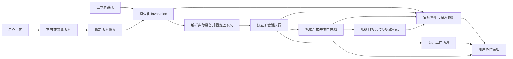

# 0031 专家协作事件、文件资源与交付

Date: 2026-10-18 (Asia/Shanghai)
Revision: 2026-10-18.4
Contract: Implemented under the user's instruction to design and start development.
Implementation: Frozen local implementation with completed regression gates and independent source review; no remaining material source finding. Reproduced repository baseline failures remain. Evidence and live acceptance limits: [verification.md](verification.md).
Mode: ENHANCEMENT with shared contracts across application and Harness.
Owner: root architect. Related contracts: 0029 attachments, 0030 reliability, 0022 storage, 0024 peer execution, 0028 isolation.
Scope row: no matching row exists. This document owns the integrated feature contract; 0029 and 0030 retain their original finding IDs.

## Summary

让上传的文件能够被当前专家及明确委托的专家读取，让用户能看到一次协作的去向、实际设备、进度与结果，并能打开最终报告。系统持久保存委托和事件，关联现有聊天与设备操作。读取附件不依赖专家的命令执行设备。

## Context and authority

The user requested diagnosis of the cloud GPU expert's paper chat, event modeling before coding, then explicitly authorized development with GPT 6.1 Sol high as coder and GPT 6 Luna high as reviewer. The user subsequently clarified that the product is in internal beta and the architecture should serve the future rather than preserve temporary patches or obsolete behavior. Root owns architecture and integration. No production deployment, live memory mutation, Git publication or new external service is part of this authorization.

Application baseline: `60111355`, `fix/paper-chat-reliability-20261017`, at `D:/Agent_Workspace/octopus/octopus-paper-reliability-20261017`. Harness baseline: `2ac4d602`, `fix/paper-dispatch-memory-20261017`, at the sibling `octop-harness-paper-reliability-20261017`. Preserve the interrupted dirty patches; the root ops directory contains start patch snapshots. Record the final tested source paths and dependency installation separately from a portable release.

Read only cloud evidence from 2026-10-18: parent `thr_01M54J707VQ9Y4VD5QABWN62HH` had 491 messages; cloud child had 51; laptop expert child had 34. Parent 478 requests delegation to the laptop expert; 481 attempts it; 483 reports no recorded result; 485 sees empty projected history; 486 retries; 487 receives a report; 489 verifies a 39,585 byte report on SSG3090 GPU. Child contexts bind expert DHSR73 to the GPU, despite the expert's default WJH-Laptop. This is intentional legacy inheritance but not clear in the product. An absent result cannot establish whether a task never executed. Source `team_manager.fan_in_peer_turn` excludes sync direct messages from room projection. Do not present these observations as proof that all collaboration failed.

## Requirements and acceptance

| ID | Observable contract and verification |
| --- | --- |
| AC1 | An existing private chat upload can be read through the actual installed `read_attachment` tool with GPU unavailable and no shell call. PDF page/range results include resource version, page provenance and extraction warnings. Group compatibility uses the same parsing service. |
| AC2 | Every new sync and async delegation exposes a persistent invocation before child execution. The receipt and inspection show caller, callee, source/child thread, root run, invocation ID, requested policy and actual resolved device. Preparation/restoration reuses one bound child context for that invocation. Overlapping attempts to the same callee use separate child threads/sessions and cannot exchange prompts, messages or results accidentally. |
| AC3 | Real PeerAgentMiddleware and TeamManager tool entrypoints expose one canonical strict schema for inherit/member_default/explicit and resource IDs. Unknown fields fail. Omitted policy now means member_default; inherit is an explicit choice. No in flight target mutation. Authorized member_default reaches the member's configured device. The application no longer patches tool function references or their schemas at runtime. |
| AC4 | Delegation can grant only specified resource versions which the authenticated caller may read. The callee can read them without obtaining general access to the caller's workspace. Another account, unrelated invocation, expired/revoked grant, changed source version or forged owner statement is rejected. A cached parse never bypasses access validation. |
| AC5 | Parent direct chat and team chat show a collaboration entry with actual device, status, failure reason and a link to owner authorized child working messages. Child messages are referenced and paged, not duplicated into the parent's model answer. Refresh/reconnect can reload persisted events with an increasing cursor and no duplicate cards. |
| AC6 | Transport lifecycle and task outcome are separate. Timeout or missing result yields unknown/reconciling, never an assertion that no work occurred. Replay of the same invocation cannot execute it again; an explicit retry creates a new attempt linked to its predecessor. Cancelled/failed attempts retain inspectable evidence. Accepted async requests persist their reconstructable assignment/options/resources before acknowledgement. Startup reconciles accepted/running records; it may resume a definitely not started request only after revalidating authority, and must expose already started uncertain work without automatically repeating side effects. |
| AC7 | A generated report can be published as an immutable resource version from its real execution backend, verified by bytes/hash, and exposed to the owning user for preview/download without uploading it again. The receipt identifies the producing expert, actual source device and file version. Merely returning an absolute path is not publication. |
| AC8 | A resource can be deliberately delivered through the existing permitted device transfer path. Completion requires target acknowledgement and checksum verification. Existing files are not silently overwritten. Target offline, denied roots or checksum mismatch produce a structured failure and no successful delivery marker. |
| AC9 | Parent and child restrictions remain at least as strict as the parent execution policy. Attachment parser scratch work is distinct from project writes. Reading/publishing from an allowed source does not grant project command access. Transfer destination writes remain subject to the existing work mode and target permissions. |
| AC10 | Completed root turns with progress and final state persist one authoritative final. Interrupted partial output is retained explicitly; valid repeated text in different messages is not deduplicated by substring. Preserve the existing nested child stream isolation. |
| AC11 | Existing memory contention work is completed and verified: replacement either commits successor, retirement and journal together or rolls back with a typed retryable busy outcome. Do not add contradictory active memory as a substitute or mutate live memories. |
| AC12 | New user facing chrome and errors have zh/en parity; no raw cloud host paths or secrets leak through cross account APIs. API schemas are typed and discoverable. Integrated regressions exercise actual tools, real SQLite persistence, fake device transfer and frontend behavior, followed by repository gates. |

## Decision

Use the existing FastAPI, database pool, backend workspace, device protocol and React chat. Add a bounded collaboration domain service and an append only event repository. Keep current chat history and run operation receipts as their respective sources. No new broker, object store, workflow engine or full event sourcing rewrite is needed.

Use the originating thread as the collaboration scope, and the existing root run for correlation. Each delegation receives a distinct server generated invocation ID. Each retry is a separate invocation linked with retry_of. Do not reuse job_id as the invocation identity: its presence currently changes sync versus group behavior.

New child thread and session identities include the invocation ID, such as `source_thread~callee~invocation`. The database stores the actual relation; HTTP never authorizes a child by parsing this string. The old source_thread~callee history remains inspectable historical data only. Prompt stashes and final result capture must use the unique child identity, including two overlapping attempts to the same expert.

The canonical default is member_default. Inherit and explicit targets remain deliberate choices. Display the requested/resolved target in every receipt. Selecting the next turn's device does not move the active execution. This is an intentional beta contract change and its tests should change with it, rather than retaining a misleading default behind a compatibility layer.

## Domain and persistence

1. **Invocation**: owner, invocation_id, source/callee agent IDs, source/child thread IDs, root_run_id, parent_invocation_id, retry_of, transport_status, task_outcome, requested target, resolved target/context, error_code, retryable, timestamps. A transport return is not evidence that the requested business result succeeded. task_outcome is unknown unless explicit structured evidence supplies it.
2. **Resource version**: owner, resource_id, version (content SHA256), name, media type, byte size, source expert/thread, source kind/device/path and controller snapshot locator, parse state and publication state. Paths are server locators, never authority. Existing uploads register lazily through exact workspace resolution. Inputs and output artifacts share this identity; published bytes are snapshots and cannot silently change under the same version.

`resource_id` identifies exactly one immutable version, derived from the authenticated source identity, source kind/path and content digest. A changed digest creates a different resource_id. `version` exposes that ID's SHA256 for verification; there is no mutable latest-version resolution behind a resource_id. Therefore HTTP lookup, frontend merge and tab references may use resource_id alone without replacing selected bytes with a newer version.

A publication reference is scoped to its source thread/invocation as well. Publishing identical bytes from the same path in two different collaborations creates distinct resource references and result reader associations, while their owner scoped snapshot digest may share the same stored bytes. One thread's first publication cannot consume another thread's association. An upload registered before a thread exists is bound through its authenticated send flow; explicit sharing then uses grants.

Resource byte limits follow the existing configured upload cap (default 100 MiB) for registration, publication, snapshot verification and delivery. Document text extraction retains its separate 8 MiB parser bound. A file between those limits remains a valid upload/resource for authorized content access and transfer; `read_attachment` reports `DOCUMENT_LIMIT` without rejecting the upload or the conversation. Exceeding the resource limit uses the existing typed attachment-too-large outcome (HTTP 413), not a new unhandled exception. This preserves the existing upload contract while bounding parser work.
3. **Grant**: owner, resource_id/version, invocation_id, callee agent, read scope, expiry/revocation. Grant creation validates the authenticated source invocation. A callee cannot manufacture a grant by providing IDs or owner prose. Revocation and account/thread ownership are checked on every read. Existing private workspace isolation remains in force.
4. **Event**: monotonic sequence, unique event_id, owner, source thread, invocation/resource correlation, event_type, causation ID, bounded payload and timestamp. Events are append only. State mutation and the corresponding event are one transaction. Do not reinterpret mutable `run_events` upserts as an immutable event log.

Create a new `029_collaboration_resources.sql` and `.pg.sql` migration pair after the actual existing maximum 028. The user's beta direction takes precedence over the older AGENTS.md suggestion to keep folding unrelated features into026. Existing installations may already have applied028, so an additive029 is the clear transition. Test fresh and existing databases; advance the applied watermark without rebuilding unrelated tables or clamping it backwards. The application coder owns migration and DB service wiring. A separate physical resource snapshot directory under managed expert storage is permitted; never put binary bodies into event payloads. Full messages remain in thread_messages/checkpoints. Public payloads use bounded summaries and references.

## Event vocabulary and lifecycle

Resources: `resource.registered`, `resource.ready`, `resource.parse_failed`, `resource.granted`, `resource.published`, `resource.unavailable`, `resource.delivery_started`, `resource.delivered`, `resource.delivery_failed`.

Invocations: `delegation.accepted`, `delegation.target_resolved`, `delegation.started`, `delegation.completed`, `delegation.failed`, `delegation.cancel_requested`, `delegation.cancel_too_late`, `delegation.cancelled`, `delegation.result_unknown`.

Transport status: accepted, running, completed, failed, cancelled, unknown. Task outcome: unknown, succeeded, blocked, failed, needs_input. Completion without a typed outcome remains task_outcome=unknown, not succeeded. Artifact verification/publication may establish delivery success for that artifact, but not unrelated scientific correctness.

Durable event acceptance precedes execution. Unique invocation/event IDs and guarded state transitions make callback replay idempotent. Reusing an active/completed invocation returns its recorded status or result rather than calling the expert again. New user turns without explicit cancel do not erase an earlier accepted delegation. Process restart does not automatically rerun an unknown side effect: reconcile saved state and expose uncertainty.

Event sequence is a database generated globally unique increasing integer, with stable event_id uniqueness and tenant/thread scoped queries. `after` is exclusive and results are ascending by sequence. next_cursor is the last returned sequence, unchanged when there are no events. has_more indicates more authorized events for that scope. The initial response includes current invocation/artifact snapshots; later responses may refresh those same ID keyed snapshots, so clients merge by ID rather than append. State/event commits serialize per invocation, with compare and set of the expected current status. Transport transitions are accepted -> running/failed/cancelled/unknown, running -> completed/failed/cancelled/unknown, unknown -> completed/failed/cancelled only with reconciled evidence. completed/failed/cancelled are terminal and cannot regress. A cancel request is an event, not a terminal state until execution acknowledges cancellation. If completion wins the race, keep completion and record that cancellation was too late.

Bound snapshot responses to the latest 500 references plus the invocation/resource references in the returned event page, deduplicated and still owner/thread scoped. A fixed earliest-500 snapshot must never hide newer tasks or prevent event pagination from resolving older cards. Runtime waits query the indexed owner/root run; startup reconciliation queries accepted/running status rather than repeatedly parsing every historical invocation. These bounds preserve discoverability while keeping each response and polling query finite.

The event log is also the recoverable notification source. Existing WS may emit a lightweight change hint after commit. Clients fetch owner authorized events after their cursor; a missed hint is recovered by opening, refreshing or bounded polling while visible. No delivery guarantee is claimed from a best effort socket alone. A future background executor may add an outbox worker without changing event identities.

## Cross repository interfaces

Harness owns first class typed dispatch fields on actual tool schemas and PeerCall data. Keep useful expert/message/mode/user_question and response/thread_id fields. Add target_policy, device_id, target_kind, working_dir, resource_ids (bounded list of registered IDs). invocation_id is runtime generated metadata, not an authorization argument supplied by the language model. Update the application and Harness as one supported contract. Remove superseded runtime tool schema monkeypatches instead of supporting two dispatch authorities. An incompatible installed Harness fails a capability check clearly before agents start; no silent fallback to old target behavior.

The app's prepare_peer_session resolves/persists invocation and target, authorizes requested resources and binds child configurable to the invocation. The child restore preserves that bound identity, target and stricter policy. record_peer_turn and error/cancellation paths persist terminal/unknown transitions and compact typed receipt metadata. Both actual construction paths must be tested, not only the patched tools module.

Root owns this contract; coders must report incompatible API details before inventing another protocol. Root will record an exact compatible signature delta in this file if necessary.

Pinned host API details for revision .2:

* `DispatchOptions` is a frozen value with target_policy, device_id, target_kind, working_dir and resource_ids. The first four preserve existing application tool names including explicit local targets. Validation rejects target fields when policy is not explicit, and invalid explicit device/local combinations. resource_ids is a unique bounded collection of opaque resource IDs; no raw paths in this field.
* `PeerCall.invocation_id` and `PeerCall.dispatch_options` define the canonical host context. All real invocations populate a runtime generated ID before acceptance. `PeerSession.receipt` returns trusted resolved target metadata. Transitional defaulted dataclass construction is permitted for bounded fixtures only, not a second production route.
* `bind_peer_session` accepts an awaited `lifecycle(call, receipt)` observer. The real async tool uses an `asubmit_peer` entry which persists accepted status before enqueue/return. The obsolete synchronous submit_peer API is removed or retained only as a fail fast deprecation which instructs the caller to await asubmit_peer; it never acknowledges/enqueues before persistence. Application callers migrate to the awaited API.
* Both sync and inbox paths observe accepted, running and terminal transitions. Preparation or accepted/running persistence failure fails closed before calling the callee. Never swallow a resource/target authorization exception and execute a default request. Terminal recording failure preserves the child result and leaves the durable previous state reconcilable; do not claim a recorded completion which was not committed.
* Receipt field names are invocation_id, transport_status, task_outcome, target_policy, requested_target, resolved_target, error_code and retryable. The application's receipt additionally links source/child thread and root run. Transport status unknown is supported. task_outcome uses the vocabulary above. Keep legacy response/thread_id on ask_agent JSON.
* Actual allowed peer checks apply to direct call, sync tool and async tool, not only name resolution. Shared external experts stay text only; resource or device grants cannot cross that restriction.

Pinned replay and retry details for revision .4:

* The lifecycle observer returns `DispatchReceipt | None` on accepted. None means the host atomically created the invocation and accepted event. A receipt means that invocation already exists, and Harness returns its recorded status and child thread pointer without executing/enqueuing it again. Other lifecycle transitions return None. Validate that a returned receipt matches the requested invocation and policy.
* Real StructuredTool execution receives hidden ToolRuntime.tool_call_id, never a language model supplied authority field. Combine it with authenticated owner, source expert and source thread/session to derive a stable UUID5 invocation ID. Distinct tool call IDs produce distinct attempts. Direct trusted Python callers may supply invocation_key; omission generates a new identity. Reusing a key with a changed immutable assignment/options/callee fails INVOCATION_CONFLICT, rather than silently returning a different task's result.
* Harness coalesces duplicate in process calls with a Future for the same ID so a concurrently replayed sync call can receive the original result. Durable duplicate detection lives in the host's atomic accepted operation, not in that memory cache. Revalidate caller and allowed peer before returning a prior record.
* Optional host authored receipt fields source_thread_id, child_thread_id and root_run_id expose the recorded result pointer on replay. No large result body needs to be copied into the event or invocation table. Already accepted/running/unknown work returns that status, never an optimistic success or a second execution.
* Canonical dispatch accepts retry_of as an optional opaque predecessor ID. Host validation requires the same owner, originating root and callee, and a failed/cancelled/unknown previous attempt. A retry uses a fresh invocation identity and preserves the predecessor record. A model supplied predecessor ID is a request subject to validation, never a permission grant.
* The invocation table's indexed thread scope is the originating root thread. source_thread_id remains the immediate caller, and parent_invocation_id retains nesting, so nested collaborations appear in the original root view. Stable status/timestamp columns support restart and compare and set queries rather than requiring whole database JSON scans.

Cancellation realization under revision .4: expose awaited `acancel_peer(invocation_id)` for both sync and background calls. Persist a same-state receipt with error_code=PEER_CANCEL_REQUESTED before asking the task to stop; the application records delegation.cancel_requested without inventing a terminal outcome. A definitely not started attempt may become cancelled. Once the callee has entered execution, a coroutine cancellation without underlying executor acknowledgement becomes unknown with that cancellation code. If completion wins the race it remains completed, and a late cancellation is recorded as too late. The host never treats cancelling a Python await as proof that a remote command's effects have stopped.

## Tools and HTTP

Register one `read_attachment` capability in ordinary direct chats and teams. Use resource_id plus pagination. A bounded legacy inbound alias adapter registers an exact authorized old upload into the canonical resource model and returns its ID/version. Remove the duplicate group parser and new use of read_group_attachment; historical tool messages remain inspectable. Preserve bounded parser subprocess/time/byte/page limits from existing interrupted work and actual dependencies. Update tool allowlists, guides, prompts and tests together rather than retaining a permanent second authority.

Expose tool operations to publish an allowed current backend file as a resource and deliver a registered resource to an explicitly permitted destination. Exact public tool names and typed body details follow existing naming conventions and must be reflected in the tool catalog, i18n and tests. Publishing cannot read arbitrary controller paths. A file on GPU is read through the current device/backend channel; a controller private path is read through its authorized BackendWorkspace.

Add owner authorized thread endpoints:

* GET `/agents/{agent_id}/threads/{thread_id}/collaboration` with after cursor and bounded limit, returning invocations, events, artifacts and next cursor.
* GET `/agents/{agent_id}/threads/{thread_id}/collaboration/{invocation_id}` returning invocation plus bounded child working messages only when the persisted relation and both owner identities match.
* GET `/agents/{agent_id}/threads/{thread_id}/resources/{resource_id}` for metadata and a companion content/download endpoint for that published version.

Authenticated tools use the same domain service as HTTP. Resource binary access does not accept caller controlled filesystem paths. Use existing auth helpers and not router to repo imports. API service names may be local implementation choices; observable contracts above are fixed.

Device materialization reuses existing protocol and ownership/grant checks, supports controller source snapshots and existing device sources, verifies acknowledgement/hash, and defaults to no overwrite. Never use shell, arbitrary URL fetching or expanded device roots to bypass a denied read/transfer.

Controller snapshot storage is a service owned directory beneath PathLayout.root, `collaboration/resources/{owner}/{sha256}`. It is not a tool readable private expert directory. Publication stages a temporary file in the same filesystem, bounds and verifies bytes/hash, flushes the file, then atomically finalizes the content addressed filename before committing resource state plus publication event. A crash before the DB commit leaves an unadvertised orphan, never a ready artifact pointing at incomplete bytes. Retrying the same resource version verifies/reuses final bytes and commits idempotently. Incomplete temporary files and unreferenced final files are never listed as published; no automatic destructive cleanup runs in this change. Startup verifies published locators before serving and reports missing/corrupt bytes as unavailable, without inventing readiness. Snapshot content and locators are never accepted from client path arguments.

Startup also revalidates references marked unavailable specifically by snapshot verification. If storage recovery restores exactly the expected bounded bytes, size and digest, atomically return that same reference to published and append `resource.ready`; preserve its immutable identity, provenance, grants and parse state. Each committed availability transition has a unique event ID and compare-and-set previous state, so unchanged repeated startup is silent while a later loss/recovery cycle remains auditable. Recovery never reruns an expert, fetches arbitrary source paths or changes the version. Runtime republication is not a disk-repair mechanism; verified existing snapshot reuse remains idempotent.

Application integration uses public Harness prepare/lifecycle hooks for target resolution, consent snapshot propagation and cancellation. Remove superseded tool builders and pending target ContextVar interceptions. Do not keep intercepting Harness private methods as the way a target/resource grant reaches the child when the new public hook carries those fields. Existing group stream projection hooks are separate and must retain their behavior until replaced by an equivalent supported hook.

## User interface

Add a compact collaboration entry to ordinary and team conversations. It shows assigned expert, actual device, transport/task status and artifact links. Expand opens a paged detail view of task prompt, public working messages and bounded operation evidence, with a link to the existing child chat. Do not show internal reasoning or private memory as collaboration messages. The actor label never substitutes for the device label.

Display bounded localized reasons for canonical error codes without rendering arbitrary backend error text, paths or provider messages. A cancellation request or unknown result must retain that meaning instead of being labelled an operation failure. Missing/corrupt startup snapshots retain their resource reference and show unavailable with disabled preview/download actions.

Published artifacts appear with name, producing expert, source device, verified version and open/download actions. Existing right side preview integration is preferred. Pending/blocked/unknown, no activity, revoked resource, loading and API failure states must be visible. Opening a detail panel does not dispatch an expert or mutate a thread. Reconnect/refresh cannot append duplicate final messages or cards.

## Build plan and ownership

1. Harness coder: actual schema and stable invocation metadata plus typed receipt/error behavior, then memory contention completion (AC2, AC3, AC6, AC9, AC11, AC12). Application coder remains responsible for target authorization and persistence. No production patching.
2. Application backend coder: persistent domain/migrations, peer lifecycle integration, resource registration/grants/common reading, owner authorized inspection and content, publication and acknowledged transfer, history reconciliation (AC1 through AC10, AC12).
3. Frontend work follows the frozen HTTP shape, reusing chat and preview components (AC5, AC7, AC8, AC12). Root may assign a separate frontend coder with disjoint paths after backend contract is ready.
4. Integrate the actual changed Harness source into the application test environment using an explicitly local development installation. Do not rewrite the release dependency to an unpublished or machine specific path. Record original lock and installed source provenance.

Local review packaging decision: after final Harness source freeze, build a wheel and retain it with its SHA256 and source manifest under a repository relative vendor directory. Use a uv source override to that portable wheel and regenerate the application development lock, so an ordinary uv run cannot silently reinstall the incompatible old Harness. The original production archive reference is recorded in the manifest. The vendor wheel and development lock are review/build artifacts, not a published release; no absolute checkout path or implicit network publication is allowed. Verify imports and integrated tests from the actual installed wheel, not only PYTHONPATH. A later approved release can replace this override with a published immutable artifact after source submission.
5. Independent GPT 6 Luna high review checks contract/source, authorization, state persistence/replay, actual call entrypoints, UI reachability and both dirty baselines. Fix material findings, rerun affected checks and perform final integrated gates (all ACs).

No implementation slice is the whole feature until its linked ACs are verified. Root owns specs, ops progress, team plan, final integration and gate scheduling. Source writers do not commit, push, rebase or deploy. Freeze source edits during final shared test gates.

## Critical test scenarios

* A private PDF reads via actual AgentManager assembled tools with a dead GPU; a child granted that one upload reads it, another child/account cannot (AC1, AC4, AC9).
* Real PeerAgentMiddleware sync plus inbox invokes with each target policy, preserves unknown argument failure and requested/resolved receipt; repeated prepare keeps context identity (AC2, AC3).
* First attempt has no result; inspection shows unknown. Callback replay does not execute twice; retry is a distinct invocation. A new user turn does not erase the old attempt's record (AC6).
* Source child report is generated on a fake GPU; publish snapshots its bytes, owner previews/downloads, acknowledged transfer places matching bytes on a fake laptop; offline/denied/mismatch fails honestly (AC7, AC8).
* Parent and child API/React detail survive refresh and cursor replay without copied answers; attempts remain individually discoverable even when they share child thread (AC5, AC10).
* Parent read only policy cannot be weakened by child or transfer arguments; source path traversal, private runtime files, source version changes and stale grants remain denied (AC4, AC9).
* Two SQLite writers contend during memory replacement; whole atomic replacement retries or rolls back, with old fact and audit consistency (AC11).

## Migration plan

Strategy: additive beta migration to a single contract. Phase 1 adds029 tables and services while leaving legacy messages/artifact references intact. Phase 2 registers new uploads and lazily imports exact authorized legacy uploads when read; no bulk history rewrite is required. Phase 3 switches the application and pinned Harness together to first class dispatch, removes temporary schema/target patches, enables owner visible collaboration inspection and resource publication. Existing stored messages remain readable throughout. New calls use the member_default policy. Old history is evidence and is never reexecuted to migrate it.

Rollback: revert application/runtime code together to its recorded source baseline and leave the additive tables and snapshot files intact for recovery. Never drop new audit events or rewrite old messages as part of rollback. No live migration or rollout runs during this development task.

Risks: API and installed Harness versions must match; an older host must not silently ignore requested target/resources. Existing DBs advance through additive029, and migration tests must guard against unrelated old schema reconciliation lowering its watermark. Resource snapshots require orphan cleanup only after references are gone; cleanup policy is a separate bounded maintenance follow up, not an automatic deletion in this change.

## Contract changes

Revision .2 follows the user's explicit internal beta direction: canonical default member_default, first class Harness contract without schema monkeypatch fallback, single attachment tool/parser, new sequential029 migration and explicit durable async reconciliation. These changes invalidate any .1 test expectation for inherit omission, folded026 DDL or duplicate group attachment registration. Security, file versions, grants, source history and all unchanged AC evidence requirements remain in force.

Revision .3 applies the independent architecture review: per invocation child sessions, explicit global cursor and guarded transition rules, crash consistent controller snapshot publication, and canonical awaited async submission. It also pins public lifecycle hooks as the context propagation boundary instead of private method interception. These are architect decisions within the user's delegated design scope; coders recheck affected AC2/AC5/AC6/AC7 cases against this revision.

Revision .4 pins the actual provider tool replay identity, atomic host acceptance return, trusted result pointers, explicit retry request/validation and root scope for nested invocations. This closes the gap between deduplicating events and actually avoiding duplicate side effects. Affected AC2/AC5/AC6 evidence is rerun against .4.

## Consequences and limits

OCR computation, a general shared filesystem, global project membership, autonomous resource scheduling and scientific experiment correctness are not introduced here. Return OCR required when text extraction cannot read the page. Earlier audit findings about stale production memories remain evidence, not permission to edit live data. Production rollout requires a separately reviewable build and authorization.

## References

Related specs 0029 and 0030, `infra/agents/teams/{team_manager,device_context,target_visibility,attachments}.py`, `infra/documents/`, `infra/db/repos/{run_events,thread_messages}.py`, `infra/execution/events.py`, `infra/devices/{service,transfers,tools}.py`, chat history/inspection routers, and the cloud message numbers recorded above.

Reasoning and alternatives: [rationale.md](rationale.md).
