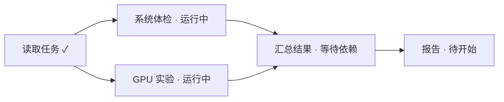

# 0034. 文件工作区、定位批注与运行 DAG

日期：2026-10-19（Asia/Shanghai）

Status: Implemented with controlled real-app evidence recorded in docs/progress-workspace-0034.md; the integrated UI has1523 passing frontend tests and zero ESLint errors. Release1.0.2b17 is authorized and its normal commit/CI/deployment gates are in progress. Revision1 approved by user on2026-10-19; revision2 adds schedules/reminders in section9.7; revisions3/4 redesign the rejected real UI in section9.8. Root visual verification does not imply user acceptance.

范围：用户已审阅交互样例并明确要求开工。交付真实文件编辑/预览/批注及任务监控 UI，使用实际应用场景验证；保留设备身份和正在运行的任务。

2026-10-20 UI 优化补充（用户继续授权，沿用 AC-Q1/AC-E1/S3/S6）：预览文件名、类型图标、版本校验与刷新/下载/批注动作合并为紧凑头部，正文获取主要高度；页码/单元格/时间控件左对齐并有可访问名称。新建批注只由新的选段、圈区或明确“评论整个文件”触发；点击已保存批注仅回定位，不自动弹出新草稿。文件路径仍可编辑并保留完整 title；文件列表与工具栏使用统一字体、清楚的当前项和键盘焦点。任务详情的标题、状态、公开输出/日志分组与定时执行记录保持同一视觉层次。保留真实状态、权限、版本和队列语义；不为优化 UI 新增外部依赖。实际 1390/894/375 页面复核后更新证据，旧冻结清单不覆盖本次修改。

本轮真实回归复现：原生工作区复用同一 Monaco 实例，切换 py→md 后撤销会把上一文件文本带入新文件草稿。编辑器实例必须以执行 context 与完整文件路径为身份边界；换文件清理旧实例和撤销历史，同一文件继续保留当前编辑历史。不得通过自动保存或清空文件修复。复验切换文件后的 Ctrl+Z 不出现其他文件文本且原字节不变。

本轮目录往返回归：正常进入子目录后返回上级，应请求父目录路径本身，不额外拼出 `child/..` 来源别名；返回后打开同一图片，应显示原有批注与回复。Windows 盘符根目录、UNC 共享根目录和 POSIX 根目录保持稳定；显式输入的点路径仍交由执行端处理，不在浏览器中消解符号链接。窄屏批注浮层应避开完整预览头部；375px 实测浮层顶部209.06px，工具条底部199.53px，无横向页面溢出。
代码实施基线：`octop-workspace-annotations-activity`，branch `feature/0034-workspace-annotations-activity`，SHA `c236203c27c26d2f4beed5bec3aa9b437919dc41`（最新 origin/main，包含0031/0033）。远端没有develop分支，故release核实后从main隔离建树。旧steering工作树不改动。

## 1. 本次要做的内容

| 功能 | 用户看见的 UI | 要补的底层能力 | 验收结果 |
|---|---|---|---|
| 远端文件工作区 | 紧凑路径栏、可调宽目录树、文件类型图标、占满剩余空间的代码编辑器 | 复用 Monaco；远端文件适配；保留版本冲突保护 | 打开 Python 显示完整可滚动编辑区域、行号、关键字/字符串/注释不同高亮；拖动面板不塌成两行 |
| 多格式预览 | 图片缩放、PDF 页、PPT 幻灯片、Word 页面、MD 渲染/源码、视频播放器 | 同一个预览分发器接收授权字节源；分块读取超过 1 MiB 的文件 | 远端、附件、成果使用一致的预览体验；错误有明确原因与替代操作 |
| 定位批注 | 选中文字/圈区域/选页/选时间段，右侧评论线程 | 与文件不可变版本绑定的锚点与持久评论 | 刷新保留批注；点击评论能回到原位置；文件变化不错误地把旧批注贴到新内容 |
| 提示 Agent 修改 | 汇总选定批注和文件版本的修改请求草稿，明确目标 Agent/设备 | 使用现有持久输入队列；结构化资源授权；结果版本关联 | 提交一次只生成一个修改请求；执行结果能回到原批注查看前后版本 |
| 聊天顶部任务摘要 | 标题与原有 Agent 头像之间的紧凑入口；单击简略，双击详情 | 聚合任务、协作调用、原生子 Agent、后台 Job 的真实记录 | 用户不打开独立页面也知道谁在运行、并行多少、什么在等待 |
| 任务详情与 DAG | 详情弹窗：依赖图、运行列表、节点详情；公开对话/日志/产物 | 稳定节点身份、明确依赖边、生命周期事件与断线恢复 | 支持分叉和汇合；并行节点分别更新；旧任务缺少数据时如实标注 |

## 2. 用户已经确定的交互

1. 子 Agent、后台任务与 DAG 的入口放在聊天顶部，标题右侧、现有 Agent 头像状态左侧，即用户第二张截图的红框位置。
2. 单击打开简略内容，不弹出大详情；双击打开详细弹窗。
3. 简略内容显示当前运行者、后台任务、等待原因、完成项数量及最近动态；提供显式“查看详情”，兼容触屏与键盘。
4. 双击不触发任何执行动作。首个单击只展开、不切换收起，第二次单击不产生重复面板；双击随后替换成详情。
5. 用户已明确“你设计完开工吧”，构成实施授权。其新增直接编辑、常见图标、运行动态图标与实际应用场景验收要求见第 9 节。

## 3. 文件工作区布局

```text
聊天标题                   子Agent 2 · 后台 2 · 并行 2      原Agent头像/状态
工作区 · SSG3090 GPU                         文件变更 / 工作区 / …
←  home / wjh / workspace / fig_candidates        刷新  上传
┌─ 可调宽目录区 ──────┬─ analyze_v5_final.py · Python · UTF-8 ───┐
│ 各类型图标与文件名   │ 源码 / 预览                    保存       │
│ .py .json .md       │  1  # 注释                            │
│ .pptx .docx .png    │  2  import ...                        │
│ .mp4 .pdf           │     全高 Monaco，独立滚动、行号、高亮     │
└───────────────────┴───────────────────────────────────────┘
```

顶部不堆叠大段说明和重复路径输入框。正常路径用面包屑；点击路径再输入。高度由宿主面板逐层传递 `flex:1 / min-height:0`，目录和内容各自滚动。窄屏目录收成抽屉，编辑区继续占主区域。

首次保留现有 1 MiB 内 UTF-8 文本编辑上限与 `expected_sha256` 乐观锁，禁止为实现预览而直接放开写入限制。大文本用分段只读查看并明确提示范围；不要将前 1 MiB 冒充完整文件。编码错误、文件读中改变、无权限、离线分别显示。

代码事实：远端 `NativeDeviceFiles` 当前使用 `Input.TextArea` 且统一 `<File>` 图标；读取要求 `fs.stat.sha256`，而设备只为 <=1 MiB 文件提供该哈希，因此不是单纯换皮就能补齐大文件预览。截图的两行问题需运行界面确认样式/布局根因，不能在未验证前断言某个 CSS 类名失效。

## 4. 统一预览与批注

### 4.1 能力矩阵

| 类型 | 预览 | 定位批注 | 修改方式 |
|---|---|---|---|
| 代码/纯文本 | Monaco、查找、行号、语言识别 | 行/列范围 + 原文摘录 | Agent 生成补丁，保持预期源版本 |
| Markdown | 渲染/源码/并排 | 文本范围、块指纹 | Agent 修改 MD，并展示差异 |
| PNG/JPEG/WebP 等图片 | 缩放、适应宽度、旋转 | 原图坐标的框/点 | Agent 按圈选区域修改，输出新文件版本 |
| PDF | 页码、缩放、按需渲染 | 页 + 归一化区域/文本摘录 | Agent 按原始文件能力处理，输出新版本 |
| PPTX | 幻灯片缩略图、翻页 | 页 + 归一化区域 | Agent 修改对应 slide，输出新 PPTX |
| DOCX | 文档分页和选择文本 | 段落/原文摘录；可选渲染区域 | Agent 修改 DOCX，输出新版本 |
| XLSX/CSV | 表格/工作表 | sheet + 单元格范围 | Agent 修改原工作簿，保留公式语义 |
| 视频/音频 | 原生播放器、时间定位 | 起止时间；视频可选帧区域 | Agent 使用可用媒体工具；不具备能力时返回明确状态 |
| 旧 DOC/PPT/XLS、特殊编码/损坏/加密文件 | 能力探测后的转换或明确不可预览 | 可评论整个文件；转换后绑定衍生版本 | 可下载/重试/选择工具，禁止伪造预览 |

现代常用格式是本轮完整交付的目标。旧二进制 Office 格式需要转换器；现仓库只有 legacy PPT 下载回退。是否加入转换运行时要先验证部署条件，不能把它悄悄算作已支持。若需要新增依赖，先在规格中补充体积、运行端和可复现验证。

### 4.2 架构决策

- 复用已有 `CodeEditor`、`DocumentPreviewCore`、`PdfDocumentPreview`、Markdown、文件类型图标和媒体组件，抽取可以注入 `fetchBlob` 的统一预览入口；不要复制出远端专属的第二套渲染器。
- 输入来源分为设备项目文件、主机项目文件、专家工作区、已登记不可变资源。前端路径只作定位；服务端从登录用户与当前 ExecutionContext 解析权限。
- 对大文件复用现有分块 transfer 能力，或增加经鉴权的有限范围字节服务；禁止一次性 base64 整个视频。是否具备 HTTP Range 决定视频可否跳转，必须真实验证，不可只测试播放首帧。
- 预览 Blob、注释和 Agent 请求使用同一个源版本。已有 ResourceService 的不可变资源/授权是复用基础，不能用哈希本身当读取权限。
- 优先本机浏览器已有渲染能力；若需要远端转换，采用有时限和资源限制的转换工作单元，并显示排队/转换/失败状态。不是每次点开文件都派一个 Agent。

### 4.3 评论模型和请求闭环

`Annotation` 包含作者、会话、资源 ID/版本、类型化锚点、正文、回复、状态、关联修改请求和结果资源。锚点按类型保存原图区域、页码/slide、文档文本摘录与段落指纹、代码行列、工作表单元格或媒体时间段。

坐标必须去掉缩放/旋转影响后归一到原资源；保存渲染器版本和原文摘录以便诊断。新版本出现时保留旧锚点，并标记“基于旧版本”；只有经验证匹配后才迁移，匹配不唯一就待重新定位。Agent 完成不自动等于用户解决批注。

流程：定位 → 填评论 → 选择批注 → 生成修改草稿 → 用户提交 → 持久队列回执 → Agent 在原执行权限内处理 → 新资源/差异 → 用户检查与解决。

提交复用 0033 的默认排队语义。运行中不会因发批注而强制中止工具；带文件和批注上下文的请求默认排队，不伪装成当前仅支持纯文本的直接插入。请求携带 command ID、选定批注及不可变资源版本，重试不重复派发。设备/权限变化和源文件冲突需要明确回执。

## 5. 任务详情与 DAG

### 5.1 不混淆的四种信息

- **计划**：Agent 声明要做的工作，可修改，有版本。
- **运行**：实际上开始的模型调用、工具调用、子 Agent invocation、后台 Job，运行状态由对应执行方上报。
- **结果**：调用结束、专家自报完成、产物存在、用户验收是不同字段。继承 0031 的 `transport_status` 与 `task_outcome` 分离。
- **观测**：最近更新时间、连接状况、是否拿到终态。断线/没记录不代表命令失败或停止。

不根据 Agent 文字判断真实并行，不根据 todo 数组位置生成依赖链，不因界面需要逐个打勾而把实际执行串行化。

### 5.2 图模型



这是分叉与汇合样例，不是当前真实任务。节点身份包括 root run、invocation/tool call/job 和 attempt。`depends_on` 只来自结构化计划/调度器的明确声明；`contains/spawned_by` 表示归属，不应混画成依赖；`retry_of` 为不同尝试的引用。运行节点关联计划节点需要显式 task ID，缺失就放“未关联活动”。无已知依赖的旧记录显示独立节点/树并标注“依赖信息缺失”。

本轮目标是观测现有执行，并展示明确声明的计划依赖；不新建一个按照图自动派发任务的第二调度系统。若需要改变调度协议，由根代理另列契约决策。

### 5.3 UI

- 顶部入口：紧凑文本与状态点，计数来自真实运行记录；可包含 `子Agent 2 · 后台 2 · 并行 2`。
- 单击摘要：按运行/等待分组，展示名称、设备、持续时间、阻塞原因和最近公开动态；最多几项，更多走详情。
- 双击详情：默认 DAG；可切换运行列表、子 Agent、后台 Job 和事件。点节点右侧展开详情。
- 节点详情：任务说明、Agent/模型/设备、状态、等待原因、时间、公开对话、工具/日志、产物和可用控制。操作权限逐项读取服务端能力，不默认所有节点都可取消。
- 后台命令展示真实 stdout/stderr、退出码、已读范围与截断提示；大日志分页。子 Agent 显示可公开的任务输入、进展和回答；无公开记录显示暂无，不编造输出。
- 对话内容沿用现有公开消息筛选，不展示私有推理、系统提示词、凭据或未经授权的其他会话。
- 没有进度分母就显示状态/耗时；已知计划显示“完成 1/5，运行 2，等待 2”，不把未知工作量变成百分比。
- 鼠标双击、Alt+Enter、显式详情操作打开同一内容；Enter 在入口上与单击一致，只打开摘要；Escape 关闭并还原焦点。窄屏保留同一顶部入口，详情改全屏层，可切可访问列表。

### 5.4 事件和恢复决策

当前 `run_events` 用相同 event_id upsert，旧 seq 不随状态更新变化，因此它是可变回执，不能拿 `seq > cursor` 直接充当增量事件总线。0031 的 collaboration event 才是现有 append-only 事件之一。必须区分二者。

先定义统一的 ActivitySnapshot 投影，按来源保存游标和观测时间；增量活动日志采用独立递增序列，状态与事件原子写入，事件 ID 去重。节点同时保持来源身份，不复制全文日志或历史消息。对暂时没有可靠生命周期钩子的来源，采用显式快照刷新并标注观测范围，不能宣称实时完整。

协议需覆盖 `snapshot(revision, through_seq)`、有序变更、游标失效后的重新快照、更新去重、终态不被旧事件覆盖、父会话结束但后台 Job 仍运行。仅连接中断时显示观测过期，并重新查询设备 Job 状态，不能自动重跑。

原生子 Agent 与专家间 delegation 是不同来源。现有 `useChatSubagents` 是安装目录，不是运行清单；仅接上该 hook 不算交付子 Agent 监控。实施前需核对已安装 Harness 公开生命周期钩子、子运行关联与公开输出边界；若缺失，新增最小公开契约并随应用锁定依赖，禁止私有 monkeypatch。

图渲染优先验证已安装 Mermaid 对结构化 ID、节点选择与稳定布局的复用可行性；若无法在状态更新中保持视角，改用交互图组件，并在规格中记录明确库与版本。最终渲染库在技术验证后由架构者拍板，coder 不静默添加。样例用静态拓扑加交互节点，不声称已做生产实现。

## 6. 验收标准

1. **AC-F1**：894×716、1390×845 和窄屏中，文件内容区域正确填充；代码至少同时显示 15 行（可用空间足够时），拉伸/切换面板不回到两行。
2. **AC-F2**：.py/.json/.md/图片/PPT/Word/视频有正确类型图标，代码语法、行号、查找可用；保存保留源版本校验与无权限只读。
3. **AC-P1**：现代常用格式逐种在真实远端样本验证；超过 1 MiB 文件、视频跳转、损坏/离线/权限撤回均有证据。
4. **AC-A1**：各支持类型的选择锚点、保存评论、点击回定位、刷新恢复通过；旧版本不错误定位到新版本。
5. **AC-A2**：从选定批注提交修改请求，队列回执与资源授权正确；重复提交不重复执行；修改后有新版本和可检查结果。
6. **AC-T1**：入口精确位于用户红框处；单击简略、双击详情、显式详情、键盘与触屏均可用，无两层闪烁/重复触发。
7. **AC-T2**：实际同时运行的两个子 Agent 和后台 Job 能分别更新；DAG 支持分叉/汇合和等待依赖，未知关系不伪造连线。
8. **AC-T3**：点节点能查看对应公开对话、真实有界日志、原设备与产物；调用完成/业务结果/人工验收清晰分离。
9. **AC-T4**：断线重连、刷新、乱序/重复事件、后台脱离父会话、同 Agent 多次尝试能正确恢复；缺结果保持 unknown 并显示原因。
10. **AC-Q1**：每个交付切片必须同时包含真实 UI、接口/运行链路、空/错/加载状态、响应式和截图证据；只有后端不算功能完成。

## 7. 通过后的实施切片与分工

| 顺序 | 交付切片 | 配套 UI 和验证 |
|---|---|---|
| 1 | 修正工作区布局，复用 Monaco/类型图标 | 完整文件编辑界面，验证高度与保存冲突（F1/F2） |
| 2 | 统一远端/资源预览字节入口 | 所有约定格式与错误状态可从真实文件点开（P1） |
| 3 | 持久定位批注与修改请求 | 选择 → 评论 → 队列 → 新版本完整路径（A1/A2） |
| 4 | 活动来源契约与真实快照 | 顶部入口 + 单击摘要先接真实数据（T1/T4） |
| 5 | 依赖与子运行链路 | DAG/节点详情/公开对话/Job 日志（T2/T3） |
| 6 | 集成审查与各端一致更新 | Windows/Linux 与浏览器真实验证、截图、构建版本和回滚记录（Q1） |

根代理：架构、规格、决策、接受或拒绝技术方案；不写应用实现。Coder：用户在GPT-6容量不足后改为GPT-6.1 (`gpt-6.1-sol`) / medium。Reviewer：GPT-6 Luna (`gpt-6-luna`) / high。Git 上传及各端更新：GPT-5.6 Luna (`gpt-5.6-luna`) / high。实施已获用户授权；仅由指定角色执行。发布基线与目标由 release 角色核对，先完成最终代码审查和验证，再执行获授权的 Git/各端更新。

目前没有找到该代码副本的 `docs/scope`；不编造关联 scope 行。此文为正式0034规格的候选源；核对基线后复制到本任务工作树 docs/specs/0034-workspace-annotations-activity.md，且只保留该仓库文件为后续权威版本。

## 8. 待用户看样例裁定

入口位置、单击/双击已由用户确定，不重复征求。样例主要让用户判断文件布局、批注侧栏和详情弹窗是否符合预期。用户已通过并授权技术验证与实现；任何变更均保留 UI 随功能验收的要求。

## 9. 已批准补充与实施契约（revision 1）

### 9.1 手动编辑与图标/动效

- **AC-E1（直接编辑）**：有写权限的用户可直接编辑常见 UTF-8 文本/代码/配置文件（如 txt、md、json、yaml、toml、csv、py、js、ts、sh、ps1、log），提供显式保存、Ctrl/Cmd+S、未保存标记、离开确认与回退；不调用模型、不派 Agent。Markdown 的源码/预览状态可切换，不能仅在预览中挂“让 Agent 修改”。二进制 Office 文档本轮可预览/批注，不伪装成文本编辑器。大文本超过既有安全编辑上限时说明只读范围和原因，不静默截断保存。
- **AC-E2（冲突）**：另一个客户端更新同一文件后，旧版本保存返回冲突并保留本地草稿；用户能刷新查看远端内容/差异，不能默认覆盖。保留原来的 `expected_sha256` 语义；权限在服务端逐次验证。源字节换行/BOM约定须经测试，不因打开保存而无意改动未编辑内容。
- **AC-I1（常见图标）**：目录/链接与未知文件各有稳定回退；沿用并扩展统一 `fileTreeIcon` 映射，覆盖 Office/PDF、图片/设计图、视频、音频、压缩包、代码/脚本、配置/数据、数据库/日志/可执行文件。包括大小写扩展名、Windows反斜杠、无扩展名、点文件 `.env`/`.gitignore`、Dockerfile/Makefile；未知扩展不报错。文件树、打开标签、成果卡共享此语义，不能每个入口不同。
- **AC-I2（运行动效）**：真实 running 节点与顶部运行摘要显示旋转/脉动图标及“运行中”文本；等待、失败、完成、取消和观测过期分别用静态可辨符号，不能全用一个绿点。尊重 `prefers-reduced-motion`：减弱/关闭动画仍保留状态符号与文本。连接断开或观测超期后停止宣称实时运行，显示“上次观测运行中/连接断开”。正在运行的工作保持其设备状态，不以 UI 离开作为取消。

计数语义：`子Agent N` 是观测范围中 active invocation 数，`后台 N` 是其中关联 Job 的 active 数；二者并非可相加的总任务数。`并行 N` 统计显式计划中同时 running 的不同 task ID，不把同一任务的 Agent、模型调用、工具与后台 Job 重复计算。没有显式 task ID 的历史活动，省略并行数，显示“关联信息不足”。子 Agent 安装目录不能参与运行计数。

### 9.2 边界服务和 HTTP 形状

保持 FastAPI → domain → repos 现有边界。Coder 先提交具体接口草案给架构者确认；下列是冻结的语义约束，路由名称可采用仓库自然命名但不可产生另一个权限系统。

1. **FileSource**：`kind`（execution/workspace/resource）、明确授权作用域、path 或 immutable resource ID、content digest/version、name、media_type、size、read/edit capabilities。ExecutionContext 身份/设备从登录用户持有的 context 解析，客户端不提供任意 owner 或落地主机目录。现有专家 store 与项目文件边界保留。
2. **预览会话**：一次 `open`/register 从当前授权源生成/复用不可变 resource/version，后续范围/Blob读取重新检查当前所有者/会话/授权。只缓存不可变字节；revoke 后不通过缓存泄露。分块接口可以沿用现有 transfer 适配，视频选择经过授权和大小边界的分段/Range源。配置上传上限和预览解析上限分开，不把文件传输上限偷换成1 MiB编辑上限。
3. **Annotation**：服务端ID、scope/作者、resource ID/version、锚点 `kind` + 类型化字段（text range/quote; page/slide+rect; image rect; sheet+range; time interval）、正文/回复、open/resolved、revision、created/updated timestamps。页面/时间/坐标必须有限且合法；字节/系统提示不作为正文接收；评论更新采用revision冲突检测。列表分页并限制正文字数。评论查/写/撤回和原资源必须在同一授权作用域，404/403符合现有公开错误惯例。
4. **修改请求**：选择评论 IDs + 各revision + source version、目标会话、command ID。服务端验证后生成包含可读意见和结构化资源引用的 queued turn，经0033现有队列提交。成功回执关联原注释；版本变动/失去权限/重复但payload不同返回冲突。不可先把条目标“已排队”再丢弃请求；跨服务事务使用可重试pending与既有command幂等，不重派。
5. **结果关联**：现有调用/资源发布证据中显式携带 modification request/reference 时，显示新产物版本/差异入口；未经显式关联的随手同名文件不算修复结果。用户手动保存文件产生的新源版本也能由UI刷新查看，旧批注保持原版本。没有报告结果则继续显示 pending/unknown，禁止自动解决。
6. **ActivitySnapshot**：owner/thread/root-run 授权下的 `nodes`, `edges`, observation timestamp/staleness, source cursors/version。Node 保留 type/task/attempt、invocation/tool/job source refs、Agent/model/device/context、independent run status/outcome/observed status、safe detail references。`depends_on` 边只来自明确结构化计划；调用/归属边可折叠，必须视觉区分；尝试引用不是调度边。

本轮首发采用**现有快照查询与有限频率刷新**汇合已持久数据，接受用户可见的轮询时延；不需要为刷新引入新的消息总线。可变 `run_events` 每轮重新查询/按 updated_at 合并且有定期完整对账，绝不只用旧seq增量游标漏更新。页面不可见时节流，重新可见立即对账。若原生子 Agent 需新增持久化，则统一最小 lifecycle records 及bounded public message references；只在需要增量推送时引入独立append-only事件。服务端重启可重建快照，不能依赖浏览器内存唯一状态。

迁移使用SQLite/PostgreSQL成对的**下一个未占用序号**，先检查发布基线的实际最大值，不覆盖已应用030。先留新增表，再切换客户端，回滚不删除历史/评论/运行证据。共享repo/服务注册/locale和迁移由唯一coder串行修改。

### 9.3 DAG渲染决策验证

优先复用本仓库已安装 Mermaid 的 layout/生成SVG，仅以服务端结构化节点ID和转义文本生成描述，安全模式strict且禁止用户自定义链接/JS/HTML。节点选择映射固定ID，不借页面全局回调授权或执行任务。运行状态更新不重置缩放/选中位置。若无法做到稳定视角与可访问节点交互，coder汇报最小 spike 证据，由架构者批准图库或本地现有图组件；不能静默引入依赖。图不可用时保留完整可访问列表，不把未知依赖绘制成伪链。

#### 9.3.1 技术验证后的渲染选择（2026-10-19，取代上文 Mermaid 优先候选）

本地依赖声明与现有 Markdown loader 表明 Mermaid 初始化使用共享单例；任务图调用 strict 与 Markdown 调用 loose 会互相影响，不能作为隔离渲染实现。架构批准 coder 提出的**本地 SVG 有限 DAG 布局**，不新增依赖：明确 depends_on 经拓扑排序按 rank 分列、固定节点 ID 排序；分叉/汇合用 SVG 路径，归属与未知关系单独分组且不冒充依赖。React 更新状态和标题，保留选择、缩放与滚动。按钮列表提供完整可达入口。

计划最多64节点。大量调用按当前 root 分组/折叠并公开图的显示范围，完整记录仍能从有界分页列表访问；不得将5000条事件直接展开成图或静默丢弃历史。缩放须计算实际滚动尺寸，“适应”须按视口计算。验证包括分叉汇合、标题更改、持续状态刷新不重置视角；真实UI证据仍是验收条件。

### 9.4 实际应用场景验收（AC-Q2，取代演示页验收）

使用隔离测试用户/新会话与项目目录，保留生产会话和GPU已有进程。测试可通过真实UI与测试provider的实际执行链路实现，不为了验证新UI而花费模型token或打断用户实验；provider必须经过真正工具/子运行/Job生命周期，硬编码UI数据不算通过。真实远端设备用只读查验或任务专用目录；没有设备访问时明确标未验证，不能冒充通过。

| 场景 | 操作与必须观测到的结果 |
|---|---|
| S1 手动维护远端脚本/配置 | 从实际文件树打开py/json/md，直接改一处并保存，重新读取字节验证，无Agent调用；第二客户端同时改文件，旧草稿保存冲突且不丢失；只读/离线状态一致。 |
| S2 检查真实工作成果 | 实际打开远端图片/PDF/DOCX/PPTX/MD/表格/视频/音频，不能全是同一实验汇报；至少图片/文档/视频含>1MiB样本；播放器跳中段/末尾正确且字节源有边界。 |
| S3 批注并修复文件 | 在真实文本选段、图片圈区、文档选页区、视频选时间保存两条评论；刷新后回定位；提交一次修改请求，真实队列receipt且重复命令不重复执行；Agent工具产生新资源后结果回链，不自动验收。 |
| S4 同时排查服务器与数据处理 | 两个子Agent分别执行任务专用目录磁盘清点/日志统计；各启动一个后台命令，真实看到2个invocation和2个关联Job；动画/公开对话/日志各自更新，身份/归属清楚。无需训练或扫描全盘。 |
| S5 DAG分叉汇合与异常 | 显式结构化 A→(B,C)→D，B/C确实重叠；D在依赖满足前等待；断网/刷新/恢复/取消与重试保持正确attempt/最终状态。没有依赖数据的历史任务留独立节点，不假造图。 |
| S6 入口与布局 | 用户红框位置单击只摘要、双击详情；键盘/触屏可达；894×716、1390×845、375窄屏编辑区、弹窗和节点无重叠；运行图标/降低动效偏好实际检查。 |

这些是实施完成的证据要求，不能只提交一份PPT或用静态样例截图关闭功能。每个slice记录确切命令/截图、环境、代码/规格revision、通过/失败/未验证和后续补齐动作；全部AC通过后再标功能完成。

### 9.5 团队与当前执行图

```
release:核对当前远端基线与工作树 ─┐
root:冻结0034契约/决策 ──────────┴→ coder:编辑/预览 → 批注闭环 → 任务监控/DAG
                                        ↓ 每个slice运行/实际UI
                                   reviewer:独立审查 → coder修复
                                        ↓ 集成门禁/真实场景
                                   release:Git/PR/各端更新核验
```

模型固定为用户最新指定的coder GPT-6.1/medium、reviewer GPT-6 Luna/high、release GPT-5.6 Luna/high；模型容量不可用不静默替换。根代理仅架构/规格/决策/接受证据，不代写应用代码。release是唯一Git写者，coder是唯一应用/测试/依赖写者，reviewer只读；各共享文件无并发写者。

### 9.6 已确认的 API 与 Harness 接缝（实施决策，仍为 revision1）

- `POST /agents/{a}/threads/{t}/file-sources/open`，请求 `kind: execution|workspace|resource`、对应 `context_id/path/resource_id`；按服务端授权取不可变快照，返回资源metadata与来源capabilities。Execution分块借助现有download.begin/chunk/close校验digest。注册为非published，预览不能制造“Agent成果”。新增execution来源的资源身份包含真实target/device/context/path及thread，避免现有非published上传identity复用导致同路径跨源串联；旧upload身份保持兼容。
- 原资源 `/content` 支持单范围 `Range`，返回正确206/416、Content-Range与Accept-Ranges。每次检查所有者/会话和原ExecutionContext当前权限；支持现有JWT鉴权方式，禁止公开匿名媒体旁路。正文数据不写入事件，鉴权参数不落评论/运行记录/截图证据。
- 资源 `/annotations` GET/POST/PATCH，分页、版本化修改和类型化锚点；线程 `/annotation-requests` POST 携带command ID、source_version及comment ID/revision，走既有0033队列。用显式request ID关联 `publish_artifact` 结果，重新检查请求/运行/资源的相同owner和线程关系，不能把任意同名文件或跨会话request当结果。
- `GET .../activity` 汇合当前快照：可见约3秒轮询，隐藏约30秒或停止、重新可见立即刷新；周期可按已有hook规范调整。新schema使用031成对迁移。没有精确根run关联的Job不强行装进本次run。
- 当前tooltext.1公开RunEventCallback已有原生task dispatch生命周期，且能提供tool/parent_run_id/subagent_type；缺稳定公开子会话/文本记录、task-ID依赖、Job结果白名单。允许在与生产wheel一致的新独立Harness源码树做最小公开扩展，沿用run_event_sink：稳定invocation/tool UUID、parent correlation、attempt、bounded public input/output、显式task_id/depends_on、白名单job_id/context。私有推理和系统消息不纳入public output。新source/wheel/锁必须一起验证；不从已修改过的旧worktree直接覆盖生产wheel。

新增明确计划协议需由coder先给具体API/工具形状，架构者决定。优先扩展现有结构化工具，不建第二任务调度器，也不因监控页面而强制任务串行化。

计划协议已批准：当前run绑定的公开 `work_plan(plan_id, revision, tasks:[{task_id,title,depends_on,status,reason?}])`，status为pending/running/completed/failed/blocked的**Agent声明**；唯一ID、依赖存在、无环、无自依赖、revision CAS。同名plan/task只在当前授权run作用域解释，不能通过参数控制owner/其他会话。该工具仅保存结构，不派发或停止任务。Agent声明状态与实际dispatch观测状态分列；并行计数使用真实绑定dispatch，不能仅因声明status=running就动画或计数。

原生task的正式公共schema可增加可选task_id/attempt关联，task_id绑定当前run明确计划；无关联旧调用依旧可执行但显示未关联。attempt由宿主生成优先，不能让重试覆盖旧调用。保存真实public task输入/回复（建议初始4k/8k上限，按repo规范调整并标截断）、公开进展与有证据parent_run_id归属的工具回执；有独立会话时链接既有history，没有独立会话就不伪造链接。需要完整记录时持久分页public message引用，不收系统消息或隐式私有推理。用户看得到的是实际公开对话/输出与有界日志，不承诺平台不公开的内部内容。

### 9.7 定时任务与自提醒查看（用户2026-10-19新增，revision2）

本节是用户明确新增的产品功能，实施授权继续有效；不在当前 Codex 聊天中创建自动化。复用应用已有 CronManager/APScheduler、0018 self_reminder 和现有定时任务页，不新建第二调度器。

**UI：** 聊天顶部仍用同一紧凑活动入口，单击摘要增加“定时 N / 自提醒 N”和最近下一次触发；空间不足时折叠次要计数而非挤掉标题/Agent。详情弹窗新增“定时任务”“自提醒”两个视图，显示当前会话关联项；有权限时可切“本 Agent 全部”，并明确标识其他会话，不能混入本会话活动计数。现有控制台定时任务页也提供普通定时/自提醒筛选及同一详情组件，避免只有聊天里能找到。

列表/详情至少包含名称或提醒目的、类型、Agent、原会话、任务内容、触发规则和实际时区、下次触发、启用/暂停/已耗尽/调度异常、最近触发及结果、公开失败原因。自提醒额外显示一次性/重复、已触发/上限和剩余次数。关闭/耗尽项保留可查看。用户本次要求查看与UI；复用普通定时已有编辑管理入口，自提醒首版只查看及定位原会话，不擅自补一个可破坏原会话语义的通用编辑器。

**语义：** 定时配置、提醒、实际触发尝试、执行中的模型/子Agent/进程Job分别表示。enabled不等于running，下一次触发倒计时不使用运行旋转动画。真正触发后才有运行尝试；等待会话锁、执行、成功投递、失败、取消/中断或未知分开显示。“text投递成功”不冒充Agent完成业务；一次性自提醒耗尽不冒充手动暂停。原始调度next_run_time由服务端实际scheduler给出；事件触发显示“等待事件”，未注册/停机/无后续触发显示明确原因，前端不自行推算interval起点或把旧时间当未来。

**契约：** 现GET /agents/{a}/cron?include_self_reminders=true已有kind/meta/self_reminder，但前端类型未接；扩展已有安全DTO和domain public projection，提供实际timezone/next_run_at/scheduler observation、授权解析的thread_id和关联状态、提醒计数与状态、可用查看/管理能力。HTTP router只映射，不直接访问scheduler私有字段。owner权限沿用现cron管理；不能因能聊天/共享Agent就读取其他用户定时prompt。session_key服务端解析真实会话owner/agent，不按字符串拆解臆造thread链接。

新增真实触发的有界持久尝试记录和分页查看，包含稳定attempt ID、cron/reminder ID、原因（timer/manual/event）、排队/开始/完成时间、实际thread/run及安全公开错误/结果引用。可复用031 workbench记录或现有合适运行仓储，由coder给具体接口后确认；原cron只有last_run_*，历史无记录如实显示，不能生成假的历史尝试。新记录必须在真实CronJob/CronDelivery生命周期写入，run绑定来自宿主实际执行；不保存系统提示、私有推理或凭据。重启后未确认终态显示unknown并对账，不自动重跑一次性提醒。已有0018次数与禁用规则保持兼容，若实际触发后scheduler仍残留耗尽任务，应修复并加回归证据。

**AC-S1：** 普通cron/interval/date、事件触发、自提醒一次/重复、暂停/耗尽/失败均可查，时区和next_run来源正确；所有者与共享Agent/跨会话权限隔离有测试。

**AC-S2：** 同一会话两条提醒及一条定时任务能从顶部摘要→对应列表→详情→真实原会话/结果；已关闭项、空/加载/错误/离线、窄屏及键盘操作有配套UI，不能只补后端字段。

**AC-S3 / S7实际场景：** 隔离测试环境通过真实调度器触发一次提醒和普通任务，观察等待/运行/终态与回链；失败、耗尽、重启恢复和重复轮询不增加触发次数。控制台筛选与聊天显示一致，计划等待不冒充active子Agent/Job或DAG依赖。未经验证的历史无attempt记录清楚提示。

#### 9.7.1 已批准实施接缝

扩展原cron列表DTO及可选thread筛选，控制台复用；聊天可提供受授权thread schedules投影。CronManager公开domain projection取得scheduler next_run_time、实际时区和观测状态；gateway/thread registry按row.session_key验证owner/agent后解析thread_id，missing时无伪造链接。提醒没有meta.scope，关联以真实session为准。

尝试记录用下一空闲迁移**032**的SQLite/PostgreSQL成对专表cron_attempts，含owner/agent/cron身份、稳定attempt ID、nullable source_thread_id与actual_thread_id、实际run/revision/状态/时间和安全公开错误。031 workbench_records强制thread外键，不接收空字符串规避约束。fresh_thread导致新会话时分别保留来源和实际会话；cron删除不级联毁掉运行证据。接口GET /agents/{a}/cron/{id}/attempts采用有界游标分页及既有owner权限；缺历史明确提示。

CronJob.run由timer/manual/event真实入口创建waiting记录，delivery取得会话锁后running并绑定actual thread；Agent request由宿主分配task_run_id并传入现有config，text仅记录delivered不造模型run。终态completed表示执行传输完成，业务结果/用户验收保持独立。启动发现未确认非终态记unknown，不自动重跑。耗尽后清实际scheduler残留；timer执行前重查enabled，但不破坏已有明确manual run-now语义。

### 9.8 用户否定初版后的界面重构（2026-10-19，revision3）

用户明确否定当前真实页面的UI，并授权继续。初版功能接入保留，界面验收全部重开。本节取代9.7关于增加两个横向tab的布局建议，业务和权限契约不变。设计由root负责，应用代码由既定coder负责。

**问题与选择：** 当前六个横向tab、原始ID纵向清单、大段空白和通用Ant Modal只是把接口堆上屏幕。局部改色不能解决任务主次。选择一个有明确导航、工作区和上下文详情的任务工作台，沿用产品主题token和现有图标，不引入新的组件库、字体或大面积装饰。

**顶部入口与简略内容：** 入口保留用户红框位置，在标题与Agent之间。高32px，图标16px，文字12px；有真实活动优先显示旋转状态和“运行中 2”，其次显示“下次 19:30”等实际下一次触发；空闲显示“任务”。正常宽度控制在160至260px，窄屏只保留可识别图标和必要运行数，完整名称放在可访问标签中。计数不能挤压头像或覆盖标题。原始子Agent、Job和定时定义数在单击浮层展开，不在入口写一串零。

单击浮层宽340px，依次显示状态标题、子Agent和后台的真实活动摘要、最近任务最多3行、下一次定时/提醒、明确的“打开任务工作台”。不使用六宫格指标卡。双击直接打开工作台并关闭摘要，不短暂留下两个遮罩；Enter/Space打开摘要，显式详情按钮和触屏入口同样能到详情。

**工作台骨架：** 桌面用居中任务工作台，宽`min(1240px, calc(100vw - 48px))`，高`min(780px, calc(100dvh - 64px))`，内部flex且`min-height:0`。顶部56px，显示“任务工作台”、截断会话标题、观测时间/连接状态和关闭。左导航152px，仅三个主项“执行现场”“定时任务”“自提醒”，带各自明确语义的数量。侧栏轻底色，主区纯产品背景，边框使用现有token，间距8/12/16/24px，正文13至14px。标题16至18px。主要文字对比清楚，不把整页信息缩成11px。

执行现场主区顶部是“全部 / 子Agent / 后台”过滤器与“关系图 / 列表”视图切换。有明确计划时默认关系图，否则默认列表并说明“暂无明确依赖”，可切换查看；不画假的线。当前过滤器的数量沿用真实投影，页面说明观测范围。关系图占剩余可用空间，工具条含适应视图/缩放/状态图例。节点宽180至220px，以任务名、状态、执行者和最近一条公开进展组成，最多三行且可选中。未关联活动以独立列表显示。列表行显示类型图标、任务名、状态、执行者/设备、时间和一条进展，不把receipt JSON当摘要。

选中执行节点时右侧展开320至360px详情，未选时工作区充分利用空间，避免永久空白栏。详情上部是名称、可见状态及执行者/设备，中部提供“进展”“公开对话”“日志”中该类型实际支持的内容。消息显示发送者、时间和可读正文，代码/日志单独等宽。无公开输出时清楚提示。任务声明和宿主状态不同时展示语义区分。run/attempt/context ID、原始回执统一收在底部“技术信息”折叠区，可复制，但不是首屏信息。

定时任务与自提醒共用列表及详情布局：主区左列表300px，右详情弹性占满；上方为“当前会话 / 本Agent全部”授权范围。列表行含类型图标、名称、启用/暂停/耗尽状态、下一次时间和最近结果；时间使用实际时区。详情首屏显示任务名、状态、下一次触发、可读规则、任务内容，再显示最近尝试时间线。提醒突出剩余次数和一次/重复类型。长任务内容默认可读折叠，最多首屏6行后展开。列表为空时居中显示短说明，详情区不留下空表单。原会话/实际执行会话使用“打开原会话”“查看此次执行”动作，原始thread ID不作超长按钮。控制台继续复用这套内容，不双层嵌套弹窗。

失败展示简明中文错误标题及可采取动作，详细错误收进技术信息；不能以整屏红色堆栈代替结果。轮询失败保留上次内容并标观测时间。初始加载用结构匹配的骨架，数据不可用显示“暂不可用”而非0；空闲、等待、耗尽不使用运行动画。

**窄屏：** 900px以下详情改为主区内返回导航，选中项后看详情，“返回任务列表”保持原选中/滚动。650px以下工作台全屏，三个主导航改成顶部可访问分段，当前标题和关闭始终可见。375px不挤三列、不出现页面横向滚动。图画布可以独立平移/滚动，工具条和关闭不可被图挤出屏幕。894×716须有至少400px高的有效任务内容区域。

**文件工作区的同一视觉标准：** 顶部一行设备/位置与路径面包屑，目录操作保持紧凑；左树240px可拖动且可收起，右侧标签/工具栏合计不超过80px，其余高度交给编辑器/预览。批注侧栏宽300px可关闭，选区后才出现批注动作，清楚显示源版本、修改请求和结果。文本直接编辑和保存是文件本身的操作。编辑器在894×716下至少显示15行代码，375px目录改抽屉，不能返回两行textarea。图标保持现有统一语义。权限/上下文错误在工作区说明缺什么并给现有选择设备/执行上下文入口，禁止为了演示扩大授权。

**构建及验收顺序：** 先替换工作台骨架与定时详情，使用真实已有两条任务检查主次；再接执行图/公开对话/日志；最后统一文件工作区及批注布局。每步对1390×845、894×716、375宽度保存真实页面证据。编译/结构测试只支持代码验证，不能代替视觉验收。root先检查截图与主要交互，明确达标后才提交冻结版本给独立reviewer；Git与各端更新仍在最终门禁之后。当前本地浏览器若不可用，记录未验证，不通过其他控制通道绕开。

#### 9.8.1 独立设计复核后的精确定义

导航“执行现场”仅用真实active状态点表示有活动，不给不可相加的总数；摘要分别标“子Agent N”“后台 N”，并行数仍按显式task去重。定时/提醒导航数为当前选定授权范围内的配置条数，包含暂停/耗尽，不能叫运行数。过滤器数量是已加载范围内对应节点数，标“已加载”；全部包括plan/subagent/delegation/job/tool/device，子Agent包括subagent/delegation，后台仅job。加载历史只影响已加载列表数，不改变顶部当前active语义；active投影截断显示“部分活动”，不得报精确全量。入口运行中优先展示分别命名的子Agent或后台计数，不将二者相加作为运行中总数。

关系图保留完整显式计划依赖，子Agent/后台筛选只过滤其关联活动列表，不删除依赖边后画出错误计划。暂时无法关联的活动继续独立显示。定时尝试按created_at降序，同时间以稳定ID排序；最新一页轮询按attempt ID覆盖合并且保留已加载历史游标，“更多历史”单独分页。started/finished为空如实显示等待/未知，不补造时间。

鼠标单击摘要使用250ms延迟；第二击取消待执行单击，关闭已有摘要，再打开唯一工作台。窗口销毁清理定时器。重复单击、Enter/Space及触屏单击均幂等打开摘要，保留2.4约定；摘要可用Escape或点击外部关闭。以明确的“打开任务工作台”按钮进入详情，不依赖双击。关闭详情后焦点返回入口。

#### 9.8.2 冻结版复核后的执行图收口

依赖图中的计划卡必须能直接看见真实执行者，不能将全部dispatch/job都折叠并错误称为“未关联”。采用计划卡内嵌执行条目：依赖箭头仅连计划卡，卡内最多3条真实关联子Agent/Job，可分别选择打开详情，显示类型、名称、独立实际状态。关联沿显式contains边传递，不能按名称或时间猜测。更多条目显示确切数量与“查看此任务全部活动”列表入口，不吞掉重试记录。卡片尺寸和rank间距须容纳条目，活跃项优先，之后按稳定ID排序；状态变化不重新自动适应/重置缩放。没有关联的活动单独标“未关联活动”，不能混入已关联项。已关联但超出图显示范围的项在完整列表仍可查。图缩放、列表、辅助按钮均可到同一实际节点详情，不能只有不可点击的文字。

顶部摘要、紧凑入口和工作台均对active_scope_truncated显示“部分活动”，不能只在深层列表显示。任务详情所有异步请求、翻页与日志须以选中节点/会话为身份边界，切换后旧响应不得覆盖新选择。连接过期状态同样作用于已打开详情的运行标签。

#### 9.8.3 运行身份与Job归属的投影规则

同一次ask_agent可能同时产生Harness dispatch回执和collaboration invocation。回执显式带invocation_id且能匹配当前owner/agent/thread/root-run范围中的真实invocation时，合并成以invocation_id为稳定ID的delegation节点。运行状态/公开对话以invocation记录为准，dispatch保留明确task/attempt及来源引用，相关contains边映射到同一稳定节点。没有匹配证据时不能按名称/时间去重；未确认的回执保持独立且计数说明可观测范围。native task没有invocation_id的调用不受影响。一次真实invocation只计一次，计划卡不是另一次执行。

active invocation计数可以包含accepted等待中的调用，但入口“运行中”文案及旋转动画只能取去重后实际status=running且观测未过期的节点。只有accepted/waiting时显示等待，不将counts.subagents这个active字段直接称为正在执行。子Agent与Job仍分别命名，不相加。

后台Job可以依据同一授权owner/agent/thread/root-run中的精确context_id与job_id，将工具回执和Job观察连接为contains。两个不同context里同名job、跨run、跨会话、缺字段或歧义候选均不能猜测关联。图归属可沿这些明确边传递，但不能把contains画成执行先后依赖。真实repo回归应覆盖并发两个Job、跨context/run的拒绝关联、ask_agent双投影去重及保留native独立调用。

Job的创建归属仅使用真实job_start回执；job_status、job_logs、job_cancel等后续观察或控制调用不成为创建父节点。合并invocation身份后再计算实际并行数，不能保留合并前的双份running观测。

定时详情的初次加载、轮询和“更多历史”共享当前item/session身份代次。切换任务后，旧请求的成功、失败与finally均不得改写新任务的数据、错误或加载状态。回归应使用延迟响应重现切换前后两个任务，覆盖三条完成路径。

上传资源若保留可变legacy_path别名，提交修改请求前同样读取当前授权来源并比较SHA与size。别名丢失或变化时返回既有ANNOTATION_SOURCE_CONFLICT且不入队；来源未变可正常提交。owner/thread与当前权限校验仍独立执行，不能把权限拒绝一概映射成版本冲突，也不能允许Agent收到已无法读取的源版本请求。

真实375×812验收暴露全屏弹窗换行到视口下方的问题。650px以下关闭桌面居中模式，弹窗容器固定覆盖视口，dialog使用100%可用宽度、border-box、margin/padding为0。样式必须采用产品真实组件prefix或语义classNames，不能用未生效的ant-modal-content选择器。关闭按钮、标题、三个导航始终在视口内，内容独立滚动。不能以负margin补偿桌面居中伪元素引起的位置错误。

### 9.9 右侧任务详情重新设计（2026-10-19，revision4）

用户再次否定revision3真实页面，红框集中在定时与提醒右侧详情。三主导航、执行现场和已有身份/权限契约保留。本节替代9.8定时详情的视觉信息顺序。不能以已完成截图检查视为用户认可。

**首屏目标：** 用户先看懂任务目的、现在状态、最近结果，再按需看内容与调度参数。取消巨大的“下次触发”灰卡、独立“触发规则/时区”标题、逐字段竖排、首屏技术信息和系统提醒模板。右侧像一张可阅读的任务记录。

**具体布局：** 详情使用20px内边距，标题18px/600，普通正文14px/1.6。顶部一行小类型图标、可换行任务目的、右侧轻量“打开会话”动作，下一行仅状态点及简洁状态、一次/重复及执行次数。状态用有语义的文字与颜色，不能只有颜色。随后一条紧凑说明，未来有真实next_run_at时“下次 今天23:30 · 每1小时”；已耗尽提醒“已执行3/3次，提醒已结束”；一次定时完成“已于23:11发送，不再触发”。时区紧随时间显示小标签或悬停完整名，技术观测状态另收起。不能将次数耗尽再次放入“下次触发”字段重复显示。标题区含底边细线，不再套大卡。

主体为两个轻量文字tab“执行记录”“任务内容”，默认执行记录。tab下方直接是最新执行结果，之后紧凑历史列表，不把所有字段和模板都堆在结果前。执行行包含状态图标、可读结果状态、右侧实际时间，下一行最多3行公开result_excerpt，可展开全文，再给“查看对话”。一条记录没有输出就明确“执行完成，未提供公开输出”。失败展示简洁原因和展开错误，不能同一页重复一大块警告与每项相同文案。等待/执行中使用真实attempt状态。技术信息仅放在底部一个折叠入口，内部按attempt分组；不在每条执行行复制一个入口。历史分页和身份代次保护保留。

“任务内容”展示普通任务原始用户prompt，支持现有长文折叠与复制。自提醒默认展示安全DTO中meta.purpose，空则使用可读名称；只有用户明确展开“查看完整执行指令”才展示已有内部SELF_CHECK_REMINDER模板。绝不解析prompt文本猜purpose，也不隐藏用户输入的普通任务内容。自提醒列表和标题优先使用meta.purpose，旧数据fallback为仅移除系统生成的self-check:名称前缀后的名称。不能擅自翻译或重写用户名称。调度规则、时区、启停和只读来源说明集中在该tab的次要“调度设置”折叠区，首屏不再重复。

**状态措辞：** completed尝试显示“执行完成”，delivered显示“消息已发送”，业务是否验收仍独立，说明放在辅助提示而非每条标题塞“未验收业务”。exhausted提醒显示“已结束”。只有真实date已到期、无下次且已记录终态的普通任务可描述为“一次任务已结束”，不能把未注册cron/调度异常粉饰成完成。保留失败与未知事实，用“调度暂不可用”等可理解文字；原始scheduler_state收技术信息。已结束项保持可查。等待与空闲不使用运行动画。

列表配套使用同一purpose和状态显示函数，条目以名称、一个状态、一个时间/结果摘要组成，避免同时重复“次数已耗尽/下次—/最近投递成功”。选中项使用低饱和主题底色和清晰选中边，不用警告红框暗示错误。列表/详情状态范围保持一致。

**通知遮挡：** 当前可见会话收到的真实push仍刷新history和会话列表，但不在同一会话上方再堆永久通知。用现有路由和document.hidden确定可见当前会话；其他会话或后台页面保持既有通知。清理同一会话已有通知时仅清理该thread已跟踪的notice keys，不销毁其他通知，不丢历史或静默吞掉其他会话提醒。该逻辑集中在现有push hook，不引入任务详情到通知模块的新耦合。

**验收：** 同一实际S7一次提醒、三次重复提醒与普通任务，在1390/894/375三尺寸检查任务目的、执行记录、任务内容、返回/关闭、长文本与通知。普通任务结束和提醒耗尽不得出现醒目的“未注册或无后续触发”大卡。375修复必须实际量测dialog位于视口内。root检查真实截图后才能冻结给reviewer，不接受只交CSS/DOM门禁。

状态复核明确：普通date任务只在scheduler_state=unregistered、无next、有效触发时间不晚于observed_at、last_status=ok且last_run_at在触发时间至observed_at之间，才投影“已结束”。失败优先显示“最近执行失败”；当前scheduler_stopped等停机/异常不能被过期date与旧成功记录覆盖。缺少这些完成证据时保留调度暂不可用，不能猜成功。提醒耗尽与执行结果仍是两个语义。

### 9.9.2 刷新恢复与真实预览布局（2026-10-20）

窄图面板（小于480px）首次进入与重置时保留节点字号并允许横向滚动，不能默认把全图压成不可辨认的小字。用户可用缩小按钮主动查看总览；图宽高仍限制在自身滚动容器内，不撑宽整个页面。

执行来源的批注身份不能使用每次打开新建的 context ID。以 owner、agent、thread、来源类型、设备或本机、服务端返回的绝对路径、SHA256、policy revision 和 grant version 形成稳定版本身份。每次重新打开仍先通过新 context 完成真实授权读取和校验，再为相同身份更新当前读取 context。任何读取失败均不得更新来源。不同设备、权限版本、内容或会话保持分离，已撤销资源不能被重新打开复活。本功能尚未发布，旧测试版本的资源和批注保留在原身份下，不自动猜测合并或改写旧修改请求。

依赖图首次进入及窗口变化时适应可视宽高，状态刷新保留用户缩放。明确分叉的列纵向居中，卡片压紧但仍容纳三条执行者。后台进程使用类型图标与可读标签，实际 ID 在详情可查。文档选段同时保留真实页码与引用文本，不能由 mouseup 文本事件覆盖已有页面区域。Word 适应宽度并提供手动缩放，缩放后仍定位同一页的归一化区域。PPT 使用库现有 contain 模式，渲染容器不添加会被库误计入内容宽度的左右 padding。

该补充用于实现既有刷新恢复与真实 UI 验收要求，用户已授权继续完成。遵守用户不再使用子 Agent 的约束，由 root 直接实现和复核，旧冻结清单不覆盖本次修改。

同一会话的多轮计划按真实 root run 分开查看，依赖图默认最近一次，可以切换此前执行。不得把多轮图同时压缩成不可读缩略图，也不得跨 run 连线。完整运行列表仍包含已加载范围的所有活动。

真实定时恢复测试发现，dashboard 队列与主动投递分别锁 thread ID 和 session key，允许同时修改同一 Harness checkpoint。dashboard 主动投递改用与输入队列相同的 channel 与 thread 锁，在当前轮结束后追加消息。IM 保留原 session 锁。不能通过放宽 Harness 的 pending work 检查来消除错误。失败尝试保留，修复后以新的实际尝试验证。

### 9.9.1 实际目录失败后的权限模式分流（2026-10-20）

实际公共 API 证实隔离设备 online=true、trust_mode=restricted，仅有文件读写及 samples 共享根授权；其 execution context 上 fs.list 返回403。原生 fs.* 按既有服务契约只允许 owner，working_dir 不是受限共享根挂载。聊天可选择 restricted 设备，却无条件渲染 NativeDeviceFiles，是界面与能力契约不匹配。修复不能提升设备信任或绕过根授权。

批准复用既有 RestrictedDeviceFiles，并加入可选 executionContext 调用适配。有 context 时所有 files.list/stat/read/write_begin/chunk/commit/abort 均通过 executionApi.call，保留 root_id 与相对路径，沿用服务端模式与当前授权检查；无 context 的设备页保留现有设备 API。ask/plan 隐藏或禁用写操作，服务端检查仍是权威。受 context 约束时不提供绕开该 context 的跨设备 transfer 入口。切换 context、设备、共享根或模式时取消或丢弃旧响应，清理旧下载资源，不把迟到的成功/错误写到新目标。

ExecutionWorkbench 对 local 或 owner 使用 NativeDeviceFiles，对 restricted 使用共享目录浏览界面。ExecutionTarget 准确描述设备 roots 和 local 无 roots 的不同形状；缺少合法设备身份或根信息时提供明确不可用状态，不强转或伪造 Device。受限共享目录本次复用其已有浏览和上传下载能力，不声称已支持原生编辑和批注。原生编辑及预览仍按 owner/local 来源合同验收；将来支持受限源编辑或批注须另设计 root 范围接缝，不可偷偷改发 fs.*。

验收需覆盖 restricted 经 context 的根选择/列表与错误重试，ask/plan 无写入路径，owner/local 保持原生面板，切换身份不串内容。先前目录为空不算通过。隔离环境已提供 available=true 的 local target，可为已有管理员创建显式 local context，仅在任务 samples 目录执行测试，不改全局默认、不提升 restricted 设备、不操作生产或 GPU。local 测试结果必须标明来源，不能替代远端 owner 设备的真实验收。
